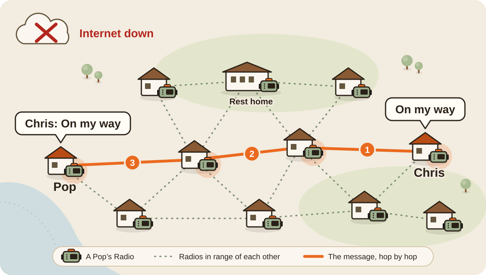

# Design Decisions

Nov 16, 2026 · @Chris Barlow · updated with decision 11, the plywood case

**The ideas are now decisions.** Until today the platform radio, the custom board and the mesh were explorations sitting beside a simpler Stage 2 build. This page locks them, so there is one radio to draw, price and build. Where another document disagrees with this page, this page wins.

Locked means the design work stops going round in circles. It does not mean tested. Nothing is built yet, and each decision below names the test that could still change it.

## What is locked

| # | Decision | Was | Detail in |
|---|---|---|---|
| 1 | **The platform radio is the radio.** Stout, about 220 × 125 × 80 mm, an orange button, a PUSH / OPEN slide switch and a small volume knob on top, a big knob on each side, a shoulder strap | "A design exploration, not a locked decision" | [Platform brief](Pop's%20Radio%20as%20a%20Platform.md) |
| 2 | **Four modes on the Mode knob:** Talk, Radio (FM), Radio (Internet) and Play. The family chooses which appear. The mesh is not a mode | Talk was the plan; the rest were ideas | [Platform brief](Pop's%20Radio%20as%20a%20Platform.md#modes-at-launch) |
| 3 | **One custom board.** A main board and three small boards cut from one panel, assembled and tested by the factory | Hand-wired breakout modules | [Cost-down report](reports/Custom%20PCB%20and%20cost-down.md#the-custom-board) |
| 4 | **The parts:** ESP32-S3-WROOM-1-N16R8, ES8388 codec, NS4150B amp on a 5 V rail, analog MEMS mic, RDA5807M FM, LIS2DH12 tilt sensor, three EC11 encoders, IP5306 charger, one 18650 cell, USB-C | "Not priced yet" | [Part choices](reports/Custom%20PCB%20and%20cost-down.md#part-choices) |
| 5 | **The screen is monochrome: a 2.4 inch TFT showing black and white only,** with a dimmable backlight, for the first boards. It plugs in, so a different panel can replace it | "Not chosen yet" | [The screen](Pop's%20Radio%20as%20a%20Platform.md#the-screen-chosen-for-the-first-boards) |
| 6 | **The talk button is a printed orange cap over a tactile switch** | An arcade button | [Cost-down report](reports/Custom%20PCB%20and%20cost-down.md#cost-down-levers-ranked) |
| 7 | **Mesh is option C: a co-processor.** A Heltec HT-CT62 runs unmodified Meshtastic beside the main chip, joined by a serial line | Three options on the table | [Meshtastic](reports/Custom%20PCB%20and%20cost-down.md#meshtastic) |
| 8 | **The mesh is connectivity, always on, and every Pop's Radio takes part.** It is a second way to connect beside Wi-Fi, and there is nothing for Pop to do with it. Each radio passes other people's messages along as well as its own | On only when docked or when Wi-Fi was down; not passing messages on | [Below](#the-mesh-always-on) |
| 9 | **Two ways to buy: a built radio or a kit.** The plans stay free for anyone building for their own family | "Parts kit" was one line in a table | [Below](#how-people-get-one) |
| 10 | **Modules for the first few, the custom board from then on.** Stage 2a builds the radio from modules to prove it; Stage 2b is 10 boards, then 100 kits | Stage 2 was a one-knob radio for NZ$35 to 50 | [Roadmap](#the-order-of-work) |
| 11 | **The case comes two ways: 3D printed or plywood.** Both plans are free. A finished plywood box can be bought with a kit | A 3D printed case only | [Below](#the-case-printed-or-plywood) |
| 12 | **4G is a plug-in board, for homes without Wi-Fi.** The modem, SIM holder and antenna sit on a small fifth board that plugs into a socket on every main board, so any radio can take one, then or later | A modem soldered on at the factory, for a separate LTE version | [Below](#4g-a-plug-in-board) |

Not changed: the [service design](Walkie-Talkie%20Service%20Design.md), Stage 1 on the two R1s, hold to talk, PUSH / OPEN, encryption, no subscription for the hardware, and "this is not an emergency alarm".

## The mesh: always on

**What it is.** A second radio inside every Pop's Radio, on 915 MHz, that needs no internet, no Wi-Fi and no mobile network. Radios within range of each other pass short text messages along, hop by hop. It uses [Meshtastic](https://meshtastic.org/), so it can join a mesh that is already there, as in Wellington.

*How it might look. Every house with a Pop's Radio is a link in the chain. A drawing, not a coverage map: real range depends on hills, walls and where the radio sits.*

**Why always on.** A mesh is only as good as the number of radios in it and how often they are awake. A radio that sleeps its mesh until the Wi-Fi fails is no help to the neighbour whose Wi-Fi failed first. So every Pop's Radio keeps its mesh radio on and passes messages along, whether or not its own family ever sends one. Each radio sold makes the mesh a little better for everyone.

**What it does.**

- **Messages when the internet is down.** A short text from the family shows in large type with a chime.
- **Nothing for Pop to do.** The mesh is not a mode on the knob, and Pop never sets it up, switches it on or sends anything with it. It is a second way for the radio to connect, and the radio uses it by itself. The orange button stays talk only.
- **Best efforts, not a promise.** A message gets through if there is a chain of radios between the two homes. Sometimes there will not be.

**What it does not do.**

- **It does not carry live voice.** The [relay report](reports/Walkie%20talkie%20without%20central%20relay.md#radio-mesh-cannot-carry-pops-voice-to-the-next-town) showed why. Hold to talk still needs Wi-Fi or mobile data.
- **It is not an emergency service.** In an emergency, call 111.
- **It cannot hear anything.** The mesh chip has no wire to the microphone.

**Settings this changes.** These replace the "quiet node" settings first suggested in the cost-down report.

| Setting | Locked value | Why |
|---|---|---|
| What Pop does | Nothing | It is connectivity, not a mode |
| Role | Client: passes messages along | Every radio is a link in the chain |
| Power | On all the time, on the stand and on battery | A sleeping radio is a gap in the mesh |
| Family messages | The family's own channel with its own key | Strangers on the public channel never reach Pop's screen |
| Other people's messages | Passed along, never shown | Pop's screen only ever shows the family's channel |
| Location | Never sent. The board has no GPS | A radio by the bed should not publish where it is |
| Name on the mesh | A nickname, not Pop's real name | Node names are public |
| Bluetooth on the mesh chip | Off | One less radio to pair; setup goes through the main chip |
| What we call it | "Mesh". The docs say it works with Meshtastic | Meshtastic's trademark rules |

**What always on costs.**

- **Battery.** About 3 days off the stand on a 3000 mAh cell, against about 13 days with the mesh off (both estimates, in the [report](reports/Custom%20PCB%20and%20cost-down.md#settings-for-a-family-radio)). The radio lives on its stand, so this mostly matters in a power cut, which is also when the mesh matters most. Measure it on the bench.
- **Money.** The mesh chip and antenna are about NZ$14 of each kit, the dearest part on the board.
- **A busier mesh.** Hundreds of new relaying radios in one city can crowd the channel. Match the local mesh's settings, keep the hop limit at Meshtastic's default of 3, and talk to the local mesh group before a large batch ships there.

**One exception.** The kids' mini phone has no mesh chip. An open mesh breaks "no strangers, ever".

## How people get one

| | Free plans | Kit | Built radio |
|---|---|---|---|
| Who it is for | Makers building for their own family | Families who can use a screwdriver, schools and community workshops | Everyone else |
| What you get | Parts list, board files, a case to print or to cut from plywood, firmware | All four boards assembled, tested and loaded, the screen, cables, both antennas, a setup card | A finished radio, charged and paired, ready for Pop |
| What you add | Everything | A case (make ours from the plans, or buy it made), a speaker and an 18650 cell | Nothing |
| Soldering | Yes, 2 to 3 hours | None. A screwdriver job | None |
| Price | Parts from about NZ$61 | NZ$89 to 99 for the first 100, towards NZ$79 at 1,000 (suggested) | Not set. Kit plus case, speaker, cell, assembly and a test |
| Channels | Run your own service, or buy channels | Bought from the [price list](Walkie-Talkie%20Service%20Design.md#prices-kept-simple) | Come with the set, paid for life |

- **Same board, same firmware, same service.** A kit radio, a built radio and a home-wired radio can all share a channel, and all take part in the mesh.
- **Why the cell is left out of the kit.** Lithium cells are awkward to air-freight and cheap to buy in New Zealand.
- **Where the money comes from.** A margin on kits and built radios, extra channels, and the family app. The hardware never needs a subscription.
- **Selling either one commercially needs a licence** from us ([COMMERCIAL.md](COMMERCIAL.md)). Building for your own family never does.

## The case: printed or plywood

**A kit needs a case, and not everyone has a 3D printer.** So there are two, and the same boards fit both.

| | 3D printed | Plywood |
|---|---|---|
| What it is | The sage green case in the concept pictures, in two halves, with rounded corners | A box of six flat panels with finger joints, about 6 mm thick, the same 220 × 125 × 80 mm outside |
| The free plan | Files to print (STL and STEP) | A one-page drawing to cut by hand, and a cutting file (SVG and DXF) for a laser cutter or CNC router |
| Tools | A 3D printer, or a library or makerspace that has one | A laser cutter, or a fretsaw and a drill. Wood glue and sandpaper |
| Or buy it made | A printed case | A finished box: glued, sanded and oiled, with the holes cut and the back panel left to screw on |
| Price | Not set | Not set |

- **Small parts are printed either way.** The two big knobs, the volume knob and the orange button cap come with a bought case, or are printed from the plans.
- **The back panel screws on.** The boards, speaker and cell go in from the back, and the cell can be changed later.
- **Why plywood.** It suits a school workshop or a shed, it needs no printer, and a wooden radio by the bed looks like furniture, not a gadget.
- **A first proposal.** The plan is not drawn. The 6 mm thickness, the joints and the finish are starting points, to be settled by building one.

## 4G: a plug-in board

**For homes with no Wi-Fi, or where it is too unreliable to trust.** Any Pop's Radio can talk over mobile data instead: plug in the 4G board, put in a SIM, and it works. Nothing else changes for Pop.

- **A fifth small board.** It carries an A7670G LTE modem, a SIM holder and a 4G antenna, and is cut from the same panel as the other four. Every main board has a socket for it.
- **Any radio, any time.** A family can order it with a kit or a built radio, or add it later if their Wi-Fi goes. It is a screwdriver job, no soldering.
- **Every main board is ready for it.** The modem draws bursts of current far above the rest of the radio, so its power feed comes straight from the cell, with a large capacitor beside the socket. It is designed in on every board, whether or not a modem is ever fitted.
- **Wi-Fi first.** If both are there, the radio uses Wi-Fi and keeps 4G as a fallback.
- **It works with the mesh, not instead of it.** 4G carries voice; the mesh carries short text when everything else is down.

| | |
|---|---|
| Cost to make | About NZ$26 at 1,000: the modem from US$12.30, the SIM holder, antenna, board and socket (estimate from the cost-down report's LTE figures) |
| Suggested price | About NZ$45 to 55, on the same margin as the kit. A suggestion, not set |
| Mobile plan | Paid by the family, separate from channels. The radio uses about 110 to 200 MB a month; a prepay plan such as Skinny at $8 per 4 weeks covers it, about $104 to $120 a year |
| Networks | LTE Cat-1, every New Zealand band including 700 MHz. 3G is switched off here, which data-only voice does not need |
| Battery | Shorter off the stand: about 2 days with the mesh always on, against about 3 on Wi-Fi (estimate) |

- **Its own certification, probably.** The 4G version emits differently, so it is likely its own declaration. Ask RSM whether a board the family plugs in themselves changes that.
- **Not in the parts pictures.** They show the standard radio.

## What it saves

All figures include GST and leave out the case, speaker and cell. They are list prices and estimates from November 2026, not quotes.

| Build | Per radio | Soldering | Against the cheapest module build |
|---|---|---|---|
| Modules, mesh on a bare HT-CT62 | about NZ$61 | 2 to 3 hours | |
| Modules, mesh on a ready-made Heltec V3 board | about NZ$103 | 2 to 3 hours | NZ$42 more |
| Custom board, batch of 100 | about NZ$58 | None | NZ$3 less, and the hours |
| Custom board, batch of 1,000 | about NZ$45 | None | NZ$16 less (about a quarter), and the hours |

The saving in parts is modest. The saving in time is the point: 100 radios from modules is 200 to 300 hours of soldering, and every joint is a place for a fault.

## The order of work

| Stage | What | Status |
|---|---|---|
| 1 | Prove the idea on two Rabbit R1s | Now |
| 2a | Build the platform radio from modules: three knobs, the TFT, FM, the tilt sensor and the mesh chip on a breadboard, then in a printed case and a plywood one. A week with Pop | Next |
| 2b | The custom board. Draw it, with the socket for the 4G board, get a real quote, build 10, test with Pop, then 100 kits | After 2a |
| 3 | Family app for iOS and Android | Later |
| 4 | A direct path between homes | Only if trials show the need |
| Later | Certify, then a batch of 1,000 and built radios on sale | After the first 100 kits |
| Later | Kids' mini phone, from the same board without the mesh chip | Idea |
| Later | Approved apps from other people | Idea |

## Still to prove

Locking a decision does not make it true. Each of these could reopen one.

| Test | Could change |
|---|---|
| Pop in front of the simulator, then a module-built radio | Decisions 1 and 2: whether more than Talk helps or confuses |
| The TFT in daylight and at the bedside | Decision 5 |
| The printed cap over a tactile switch, under Pop's palm | Decision 6 |
| The HT-CT62 serial link on a breadboard | Decision 7 |
| Battery life with the mesh always on | Decision 8 |
| Mesh range from inside the case, and inside a house | Decision 8, and whether the antenna can stay inside |
| FM reception with the wire in the strap | Whether FM stays |
| A plywood box built from the plan, with the boards in it | Decision 11: panel thickness, the joints, whether the knob shafts and the screen reach through, and how the speaker sounds in wood |
| A 4G board in a radio, on battery, in a house with weak signal | Decision 12: the power feed, whether the antenna works inside the case, and battery life |
| RSM's view on a 4G board the family plugs in | Decision 12, and whether it can be sold as an add-on |
| A real quote from JLCPCB and Heltec | Every price here |
| RSM's view on kits, and testing in the 915 MHz band | Decision 9, and when kits can be sold |
| Legal advice on Meshtastic's GPL protobufs | Direct messages and voice clips over the mesh |
