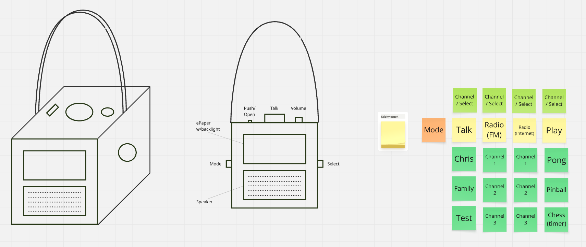
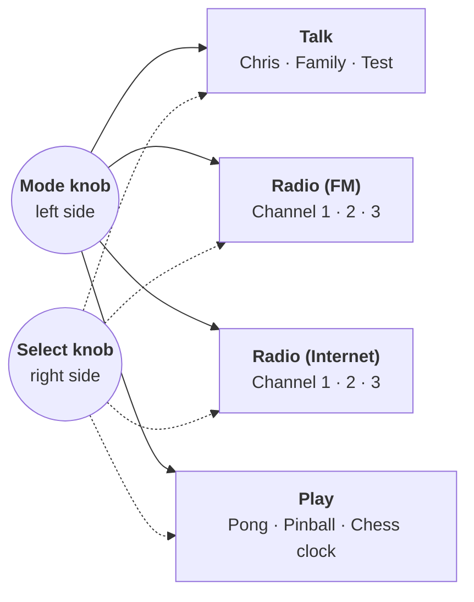

# Grandad's Radio as a Platform

Nov 15, 2026 · @Chris Barlow

A design exploration, not a locked decision. The [Stage 2 spec](Walkie-Talkie%20Beyond%20the%20R1%20Minimum%20Hardware.md#recommended-build) and the [service design](Walkie-Talkie%20Service%20Design.md) stay as they are. This brief asks what happens if the same radio can do more than talk, and what has to be true for that to stay safe and simple for Grandad.

Concept picture prompts for this unit are in [Grandad's Radio Platform Image Prompts](Grandad's%20Radio%20Platform%20Image%20Prompts.md).

## Summary

**The idea: design Grandad's radio as a platform, not just a radio.** The parts that make a good walkie-talkie (a speaker, a screen, knobs, Wi-Fi, a small computer that updates itself) are most of what a bedside radio, a games board and a chess clock need too. Once Grandad trusts one device, each extra useful thing on it is one less gadget to learn.

- **A new shape.** A box with a carry strap and three big knobs that are easy to grip and turn. Every knob is also a button.
- **Mode and Select.** The left knob picks what the radio is doing: Talk, Radio (FM), Radio (Internet) or Play. The right knob picks within it: who to talk to, which station, which game.
- **Tip it on its back to play.** Screen facing up, the two side knobs become a left and right controller: Pong paddles, pinball flippers, or the two sides of a chess clock.
- **An approved app store, later.** Once the first-party modes have proven the model, other people could build apps for it. Every app is reviewed and signed by us, installed by the family from the family app, and can never use the microphone or the talk button.
- **One rule keeps it Grandad's radio.** The orange button always talks, in every mode, and an incoming message always wins. The family chooses which modes appear, and a radio can ship with Talk only.

## What changed from the original design

*The design board: the box with its strap, the front view with labels, and the modes on sticky notes.*

| | Original bedside radio | Platform unit |
| --- | --- | --- |
| Shape | Squat wedge, sloped front | Upright box with a carry strap over the top |
| Talk button | Big orange button on top | Same |
| PUSH / OPEN | Chrome toggle on the front | A smooth slide switch on top, left of the orange button |
| Knobs | One, on the front, picks the channel | Three, all large and all pressable: Volume on top right of the orange button, Mode on the left side, Select on the right side |
| Screen | Small one-colour OLED | A larger paper-like screen with a light (see [The screen](#the-screen-epaper-will-not-play-pong)) |
| Speaker | Grille beside the screen | Wide grille below the screen |
| Orientation | Sits upright | Sits upright, or lies on its back as a games board |
| What it does | Talk | Talk, FM radio, internet radio, games, chess clock, and approved apps later |

## The controls

Every control keeps one job wherever possible, and every turn and press is spoken aloud, as in the existing design.

| Control | Where | Turn | Press | Hold |
| --- | --- | --- | --- | --- |
| **Orange button** | Top, centre | | Hold to talk, in every mode | |
| **PUSH / OPEN** | Top, left of the orange button | | Slide: push-to-talk or hands-free, unchanged | |
| **Volume knob** | Top, right of the orange button | Volume | Pause or resume whatever is playing | |
| **Mode knob** | Left side | Choose the mode: Talk, Radio (FM), Radio (Internet), Play | Say where I am, out loud | Two seconds: go home to Talk |
| **Select knob** | Right side | Choose within the mode: person, station, game | Choose. In Talk: replay the last message | |

In the games board position the two side knobs belong to the game instead: left player and right player.

**Why the switch is smooth.** A slide that sits flush in its slot has no lever to catch a sleeve or the strap, and its position can be felt with a fingertip. It is still a real switch, so open channel mode can only ever be turned on at the radio.

**Why the knobs are big.** A knob about 40 to 50 mm across with deep ribs can be turned with a whole hand, by someone with arthritis or a weak grip. That is my estimate of a good size, to be tried with Grandad on printed knobs before choosing parts.

## Modes at launch

| Mode | Select knob picks | How it works | Notes |
| --- | --- | --- | --- |
| **Talk** | Chris, Family, Test | The existing walkie-talkie, unchanged | Always the first mode, and always where the radio goes home to |
| **Radio (FM)** | Channel 1, 2, 3 | An FM receiver chip on the I2C bus, with three presets set from the family app | Works without internet or Wi-Fi, so it still plays during an outage on battery |
| **Radio (Internet)** | Channel 1, 2, 3 | Streams over Wi-Fi, with three presets set from the family app | Reaches stations FM cannot, such as a station from home for someone who moved countries |
| **Play** | Pong, Pinball, Chess clock | First-party games written by us, see below | Best played on its back |

Presets are set by the family, not by tuning at the radio. Grandad turns to "Channel 1" and hears his station; the screen and the spoken name say which one it is.

## On its back: the games board

Lay the radio on its back with the strap folded behind and the screen faces up. The Mode knob is now on the player's left hand and the Select knob on the right. A tilt sensor tells the radio which way up it is, so it can offer Play when it is laid down. This part is a design proposal and hasn't been tested.

| Game | Left knob | Right knob | Who plays |
| --- | --- | --- | --- |
| **Pong** | Turn: left paddle | Turn: right paddle | Two people side by side, or one person against the radio holding both knobs |
| **Pinball** | Press: left flipper | Press: right flipper | One person, both hands |
| **Chess clock** | Press: left player ends their turn | Press: right player ends their turn | Two people, one either side of the board. Volume press pauses |

The chess clock is the clearest case for a platform. A rest home lounge already has chess sets and players, and a chess clock is a separate thing to buy and learn. Here it is a mode on a radio that is already in the room. The [market report](reports/NZ%20addressable%20market%20and%20opportunities.md) names activities budgets as one way into aged care; shared games are something an activities coordinator can use with a group.

**Later: play against the family.** Pong over the family's own channel, with Grandad on his radio and a grandchild on theirs or in the family app. It would use the same service, with game moves sent as small sealed messages like voice. Not designed yet.

## Why a platform

- **The hardware is mostly there.** Stage 2 already has an ESP32-S3, Wi-Fi, a speaker, a screen, a knob and signed automatic updates. A platform adds two knobs, a tuner chip, a tilt sensor and a better screen, not a new product.
- **More reasons to keep it near.** A radio that also plays the morning news and keeps the chess clock gets used every day, so it is in reach and charged when the family calls.
- **A better answer to price.** The market report finds the business is only worth pursuing at a higher price, with sales beyond New Zealand and low support costs. A radio that does five useful things can carry a higher price than one that does one.
- **Income that is not a subscription.** Apps bought once by the family, through the family app, give the service income without breaking the "no subscription, ever" promise for the radio. That helps with the service design's "app revenue too low" risk.
- **It lasts longer.** New apps arrive over the update system that already exists, so the radio keeps getting more useful instead of being replaced.

## The risk: it stops being one button

The README promises "a small radio that does one thing". A platform pulls the other way. These rules are what make it acceptable, and every app in the store has to follow them.

1. **The orange button always talks.** In every mode, in every app. Holding it fades the radio or pauses the game and talks on the last Talk channel used.
2. **Incoming messages always win.** A message from the family pauses the game or fades the radio, plays, then hands back.
3. **The family chooses the modes.** Modes are switched on from the family app. A radio can ship with Talk only, and then the Mode knob just says "Talk".
4. **Home is always one gesture away.** Hold the Mode knob for two seconds to go back to Talk, from anywhere.
5. **The microphone is never shared.** Third-party apps cannot use the microphone, the talk button or the talk channels. "Nobody can switch the microphone on from somewhere else" stays true.
6. **Nothing to buy at the radio.** No adverts, no accounts, no purchases and no sign-ins on the radio. Anything that costs money happens in the family app.
7. **One way to use it.** Every app uses the same knob grammar (turn to choose, press to pick, Volume press to pause) and speaks its choices aloud.

## The app store

**Approved, not open.** Every app is reviewed against the rules above and signed by us before it can reach a radio, in the same way the firmware is signed. There is no way to load an unsigned app on a normal radio. Home builders can still switch on a developer mode on their own radios.

**Installed by the family.** Apps are found, bought and switched on in the family app, then arrive at the radio overnight through the existing signed update system on R2. Grandad never sees a store.

**Sandboxed.** Apps run in a sandbox on the radio, never as native firmware, so a bad app cannot break the voice path. One candidate is WebAssembly: Espressif publishes the WebAssembly Micro Runtime (WAMR) as an ESP-IDF component that lists the ESP32-S3 as supported ([Espressif](https://components.espressif.com/components/espressif/wasm-micro-runtime/versions/2.4.0/examples/esp-idf)). A small scripting language is the other. Whether either can run a game alongside live voice without audio glitches has not been tested; voice must keep its own core.

**What an app can ask for.**

| Allowed | Never allowed |
| --- | --- |
| Screen, speaker, the three knobs, tilt, time, a little storage | Microphone, orange button, PUSH / OPEN switch, talk channels |
| Spoken prompts in the radio's voice | Adverts, purchases, accounts or links |
| Network access only to hosts declared at review, through the service | Any host not declared at review |

**Building apps.** The [site's simulator](https://cgbarlow.github.io/walkie-talkie/) becomes the emulator: three knobs, the orange button, both orientations and the real screen size. Developers build and test there, then submit. Phasing: first-party modes only at first, then a small set of invited developers, then an open submission process with review.

**Commercial terms are open.** The code is licensed for non-commercial use, so a developer selling apps needs separate terms: a licence for the SDK, the revenue split and what review costs. See [COMMERCIAL.md](COMMERCIAL.md).

## Hardware changes from the Stage 2 build

Not priced yet. Each line needs a part chosen and a NZ price checked.

| Part | Stage 2 build | Platform unit | Note |
| --- | --- | --- | --- |
| Knobs | One rotary encoder with push | Three rotary encoders with push, large knobs | Endless rotation, so games can use them (see open questions) |
| Screen | 0.96 to 1.3 inch one-colour OLED | Larger reflective screen with a light | See below |
| FM | None | FM receiver chip, I2C, with a wire antenna | The RDA5807M is a common choice, controlled over I2C, with an ESP32 and MAX98357A example in the pu2clr library ([pu2clr](https://www.github.com/pu2clr/RDA5807)) |
| Antenna | None | A wire of about 75 cm run through the carry strap | Hobby guides give about 75 to 77 cm as a quarter-wave whip for FM ([101 Things](https://101-things.readthedocs.io/en/latest/fm_radio.html), [Seeed](https://wiki.seeedstudio.com/Grove-I2C_FM_Receiver/)). Hiding it in the strap is a proposal, untested |
| Tilt sensor | None | A small accelerometer | Knows upright from lying on its back |
| Battery | Skipped on Grandad's docked unit | Needed | A carry strap means it leaves the dock. A larger cell than 1000 mAh, size to be measured |
| Case | Wedge | Box with strap anchors and four rubber feet on the back | The feet keep it flat and steady as a games board |
| Speaker | 50 mm, 3 W | Larger, in the bigger box | Music needs more than speech does |

### The screen: ePaper will not play Pong

The sketch calls for ePaper with a backlight. ePaper reads beautifully and draws almost no power, but it cannot do games. A full refresh takes about 2 seconds on small black-and-white panels and partial refresh about 0.3 seconds ([Waveshare](https://waveshare.com/wiki/2.13inch_e-Paper_HAT%2B)), and partial refresh cannot be used all the time without ghosting ([Microchip](https://developerhelp.microchip.com/xwiki/bin/view/software-tools/mgs/dev-kits/epd-ug/fundamentals/)). A Pong ball needs many frames a second.

| Screen | Reads like paper | Games | In the dark | Verdict |
| --- | --- | --- | --- | --- |
| ePaper with a light | Yes | No | Needs a front light | Only if Play is dropped |
| Sharp Memory LCD with a front light | Nearly | Yes: the Playdate console runs games at 30 fps on one, up to 50 ([Playdate SDK](https://sdk.play.date/designing-for-playdate)) | Reflective, so needs a front light | **First choice to test** |
| Ordinary backlit LCD | No | Yes | Yes | Fallback: cheap and fast, but glows and is harder to read in daylight |

Two things to test on the breadboard: how fast the ESP32 can push a full frame to a memory LCD over SPI while voice is running, and whether a front light can be found or made for one.

## Where it fits in the roadmap

This is not Stage 1 or Stage 2, and it does not change them. It sits with the kids' mini phone as a later idea. Stages 1 and 2 should not close the door on it: keep the C core free of any one screen or knob layout, and keep "modes" in mind when writing the radio's user interface.

The cheap way to learn whether it is worth doing:

1. **Simulator first.** Add the three knobs, the modes and Pong to the site's simulator. Sit with Grandad in front of it on a tablet and see whether he wants more than Talk, and whether the Mode knob confuses him.
2. **Printed knobs.** Print knobs at three sizes and let him choose.
3. **Breadboard the screen.** Pong on a memory LCD driven by an ESP32-S3, with voice running.
4. **Chess clock in a rest home.** A single radio as a chess clock and FM radio in a lounge, as a no-risk pilot with an activities coordinator.

## Open questions

- **Does Grandad want it?** The whole case rests on more modes adding value without adding confusion. The simulator test answers this before any hardware.
- **End stops or free turning?** The Stage 2 knob stops at each end, so "fully left is always channel one". Pong paddles need knobs that turn freely. This brief takes free turning plus "hold Mode to go home", which loses the end-stop habit. A knob with a motor that can make its own stops would keep both, at a cost not checked.
- **Which screen**, and can it be lit for the bedside at night.
- **FM reception indoors** with the antenna in the strap, and what happens when the strap is folded behind for games.
- **Apps and voice together.** Can the ESP32-S3 run a sandboxed game and live voice at once? Voice keeps priority.
- **Internet radio rights.** The radio would only play a station's own public stream URL, set by the family. Check what stations allow before offering a station list.
- **Store economics.** The revenue split, the cost of review, and the licence for developers.
- **Who reviews, and against what.** Accessibility for older users, privacy, and the seven rules above. A written review standard comes before any outside app.

## Sources

- Playdate's display and frame rate: [Designing for Playdate](https://sdk.play.date/designing-for-playdate)
- ePaper refresh times: [Waveshare 2.13 inch e-Paper HAT+](https://waveshare.com/wiki/2.13inch_e-Paper_HAT%2B), [Waveshare ESP32 e-Paper tutorial](https://docs.waveshare.com/ESP32-Peripheral-Tutorials/Display/E-Paper)
- ePaper partial refresh and ghosting: [Microchip ePaper fundamentals](https://developerhelp.microchip.com/xwiki/bin/view/software-tools/mgs/dev-kits/epd-ug/fundamentals/)
- FM receiver and antenna: [pu2clr RDA5807 library](https://www.github.com/pu2clr/RDA5807), [101 Things FM radio](https://101-things.readthedocs.io/en/latest/fm_radio.html), [Seeed Grove I2C FM Receiver](https://wiki.seeedstudio.com/Grove-I2C_FM_Receiver/)
- WebAssembly on the ESP32-S3: [Espressif WAMR component](https://components.espressif.com/components/espressif/wasm-micro-runtime/versions/2.4.0/examples/esp-idf)
