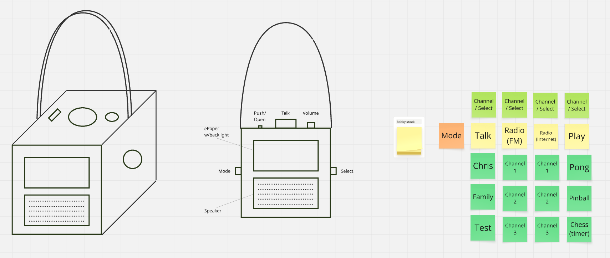
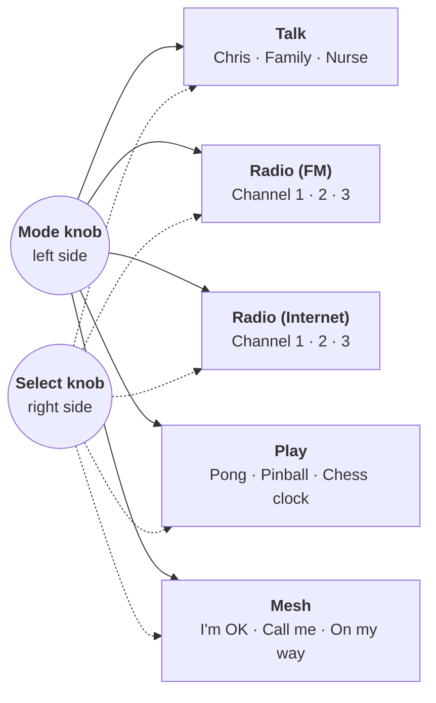
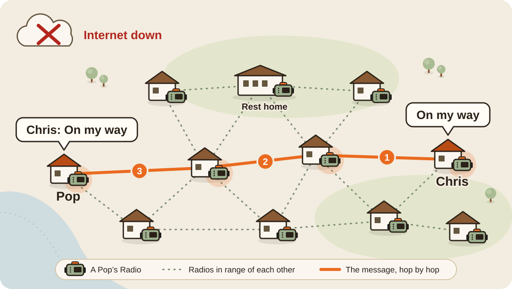

# Pop's Radio as a Platform

Nov 15, 2026 · @Chris Barlow

> **Locked on 16 November 2026.** This began as a design exploration. It is now the radio we are building: the shape, the three knobs, the modes, the screen and the parts are decided, and a fifth mode, Mesh, has been added. The decisions and the tests that could still change them are in [Design Decisions](Design%20Decisions.md); the parts and prices are in the [cost-down report](reports/Custom%20PCB%20and%20cost-down.md). The [service design](Walkie-Talkie%20Service%20Design.md) is unchanged.

This brief asks what happens if the same radio can do more than talk, and what has to be true for that to stay safe and simple for Pop.

Concept picture prompts for this unit are in [Pop's Radio Platform Image Prompts](Pop's%20Radio%20Platform%20Image%20Prompts.md).

## Summary

**The decision: Pop's Radio is a platform, not just a radio.** The parts that make a good walkie-talkie (a speaker, a screen, knobs, Wi-Fi, a small computer that updates itself) are most of what a bedside radio, a games board and a chess clock need too. Once Pop trusts one device, each extra useful thing on it is one less gadget to learn.

- **A new shape.** A stout rectangular radio, long and low, about 220 mm wide, 125 mm tall and 80 mm deep, so it sits low and is hard to knock over. It has an adjustable shoulder strap and three knobs that are easy to grip and turn: a big one on each side and a smaller volume knob on top. Every knob turns freely and is also a button.
- **Mode and Select.** The left knob picks what the radio is doing: Talk, Radio (FM), Radio (Internet), Play or Mesh. The right knob picks within it: who to talk to, which station, which game.
- **Tip it on its back to play.** Screen facing up, the two side knobs become a left and right controller: Pong paddles or pinball flippers.
- **A chess clock, standing upright.** It sits beside the board and each player taps the orange button with a palm to end their turn.
- **A mesh that is always on.** Every radio carries a second, long-range radio that passes short text messages from radio to radio with no internet. See [Mesh](#mesh-messages-with-no-internet).
- **An approved app store, later.** Once the first-party modes have proven the model, other people could build apps for it. Every app is reviewed and signed by us, installed by the family from the family app, and can never use the microphone or the talk button.
- **One rule keeps it Pop's radio.** Holding the orange button always talks, in every mode, and an incoming message always wins. The family chooses which modes appear, and a radio can ship with Talk only.

## What changed from the original design



*The design board: the radio with its strap, the front view with labels, and the modes on sticky notes. The sketch is drawn close to a cube; the unit is now wider than it is tall and not as deep.*

| | Original bedside radio | Platform unit |
| --- | --- | --- |
| Shape | Squat wedge, sloped front | Stout rectangle, long and low, about 220 × 125 × 80 mm, with a long, narrow adjustable shoulder strap, about 20 mm wide |
| Talk button | Big orange button on top | Same |
| PUSH / OPEN | Chrome toggle on the front | A smooth slide switch on top, left of the orange button |
| Knobs | One, on the front, picks the channel, with end stops | Three, all large, free turning and pressable: Volume on top right of the orange button, Mode on the left side, Select on the right side |
| Screen | Small one-colour OLED | Larger, still one colour, and readable at night (see [The screen](#the-screen-chosen-for-the-first-boards)) |
| Speaker | Grille beside the screen | Wide grille below the screen |
| Orientation | Sits upright | Sits upright, or lies on its back as a games board |
| What it does | Talk | Talk, FM radio, internet radio, games, chess clock, and approved apps later |

## The controls

Every control keeps one job wherever possible, and every turn and press is spoken aloud, as in the existing design.

| Control | Where | Turn | Press | Hold |
| --- | --- | --- | --- | --- |
| **Orange button** | Top, centre | | A quick tap: nothing, except in the chess clock, where it ends your turn | Hold to talk, in every mode |
| **PUSH / OPEN** | Top, left of the orange button | | Slide: push-to-talk or hands-free, unchanged | |
| **Volume knob** | Top, right of the orange button | Volume | Pause or resume whatever is playing | |
| **Mode knob** | Left side | Choose the mode: Talk, Radio (FM), Radio (Internet), Play | Say where I am, out loud | Two seconds: go home to Talk |
| **Select knob** | Right side | Choose within the mode: person, station, game | Choose. In Talk: replay the last message | |

In the games board position the two side knobs belong to the game instead: left player and right player.

**Tap or hold.** The orange button does two different things, told apart by time. Holding it talks, always. A quick tap is only a tap: nothing is sent, because the radio does not open the microphone until the button has been held past the ready chirp. That leaves the tap free for first-party modes to use, and the chess clock is the only one that does. The length of the gap between a tap and a hold is to be tried with Pop; this is a design proposal and hasn't been tested.

**Why the switch is smooth.** A slide that sits flush in its slot has no lever to catch a sleeve or the strap, and its position can be felt with a fingertip. It is still a real switch, so open channel mode can only ever be turned on at the radio. Its position has to be obvious at a glance: a small switch whose thumb sits hard against one end of its slot or the other, never looking halfway, with PUSH and OPEN printed at the ends.

**Why it is stout.** A radio that is pressed on top, turned from the sides and picked up by a strap must not tip over. So it is wider than it is tall and 80 mm deep, with the battery low in the case and rubber feet underneath. The case is one plain shape with straight sides; the steadiness comes from its proportions and weight, not from a flared base. Pressing the orange button pushes it down onto the table, not over.

**Why the knobs are big.** A knob about 40 mm across with deep ribs can be turned with a whole hand, by someone with arthritis or a weak grip. The side panels are 80 mm deep, so there is room to go a little bigger if he wants. The volume knob on top is smaller, about 25 mm, so the orange button (about 40 mm) stays the biggest thing on top and the one a hand lands on. That is my estimate of a good size, to be tried with Pop on printed knobs before choosing parts.

**Why the knobs turn freely.** All three knobs turn round and round with no end stops, so the side knobs can drive Pong paddles and anything else an app needs. This is decided. It gives up the Stage 2 habit that "fully left is always channel one", so the way home is a gesture instead: hold the Mode knob for two seconds to go back to Talk. Whether the knobs click at each step, or turn smoothly, is still to be tried with Pop.

## Modes at launch



| Mode | Select knob picks | How it works | Notes |
| --- | --- | --- | --- |
| **Talk** | Chris, Family, Nurse | The existing walkie-talkie, unchanged | Always the first mode, and always where the radio goes home to |
| **Radio (FM)** | Channel 1, 2, 3 | An FM receiver chip on the I2C bus, with three presets set from the family app | Works without internet or Wi-Fi, so it still plays during an outage on battery |
| **Radio (Internet)** | Channel 1, 2, 3 | Streams over Wi-Fi, with three presets set from the family app | Reaches stations FM cannot, such as a station from home for someone who moved countries |
| **Play** | Pong, Pinball, Chess clock | First-party games written by us, see below | Pong and pinball on its back; the chess clock upright |
| **Mesh** | A ready-made message, such as "I'm OK" | Sends a short text from radio to radio with no internet, see [Mesh](#mesh-messages-with-no-internet) | The mesh radio itself is always on, whether or not this mode is shown. The message list is an example, set by the family |

**The Nurse channel is for talking, not for emergencies.** In a rest home, a channel to the nurses' station is an obvious third name beside Chris and Family. It is an ordinary talk channel: someone has to be listening at the other end. It does not replace the home's call bell, and the radio is still not an emergency alarm. A rest home would need to agree who answers it and when.

Presets are set by the family, not by tuning at the radio. Pop turns to "Channel 1" and hears his station; the screen and the spoken name say which one it is.

### What the screen shows

All the modes sit in a row across the top of the screen, with the current one highlighted. Turning the Mode knob moves the highlight along the row. Below it are the choices for that mode, with the current one highlighted, and the Select knob moves that highlight.

```
+--------------------------------------+
| [TALK]    FM      NET      PLAY      |
|                                      |
|   CHRIS                              |
| [ FAMILY ]                           |
|   NURSE                              |
+--------------------------------------+
```

- **Each knob has its own highlight.** The top row belongs to the Mode knob on the left, the list belongs to the Select knob on the right.
- **Only the family's modes appear.** If the family has switched on Talk and FM only, the row shows just those two. With Talk only, there is no row at all.
- **Games use the whole screen.** The row goes away while Pong or the chess clock is running and comes back when the game is paused.
- **The labels are short on purpose.** "NET" stands for Radio (Internet) here. The right words for Pop are still to be tried; the names are also spoken aloud as the knob turns.

## On its back: the games board

Lay the radio on its back with the strap folded behind, and the screen faces up. The Mode knob is now on the player's left hand and the Select knob on the right. A tilt sensor tells the radio which way up it is, so it can offer Play when it is laid down. This part is a design proposal and hasn't been tested.

| Game | Left knob | Right knob | Who plays |
| --- | --- | --- | --- |
| **Pong** | Turn: left paddle | Turn: right paddle | Two people side by side, or one person against the radio holding both knobs |
| **Pinball** | Press: left flipper | Press: right flipper | One person, both hands |

### Upright: the chess clock

The chess clock is played with the radio standing the right way up, beside the board and side on to both players, where a chess clock normally sits. Both can see the two times on the screen.

| Control | In the chess clock |
| --- | --- |
| **Orange button** | Tap with a palm: end your turn. The other player's clock starts. Hold: talk, as always |
| **Select knob** | Before the game: turn to choose how long each player gets, press to start |
| **Volume knob** | Press: pause or resume both clocks |

One big button on top that both players slap in turn is how a chess clock already works, so nobody needs it explained. An arrow on the screen shows whose clock is running.

The chess clock is the clearest case for a platform. A rest home lounge already has chess sets and players, and a chess clock is a separate thing to buy and learn. Here it is a mode on a radio that is already in the room. The [market report](reports/NZ%20addressable%20market%20and%20opportunities.md) names activities budgets as one way into aged care; shared games are something an activities coordinator can use with a group.

**Later: play against the family.** Pong over the family's own channel, with Pop on his radio and a grandchild on theirs or in the family app. It would use the same service, with game moves sent as small sealed messages like voice. Not designed yet.

## Mesh: messages with no internet

**Every Pop's Radio carries a second radio that needs no internet, and it is always on.** It is a small Meshtastic chip on 915 MHz, beside the main chip. Radios in range of each other pass short text messages along, hop by hop, so a message can cross a suburb when the Wi-Fi, the mobile network or the power is down.



*How it might look. A drawing, not a coverage map.*

- **Mesh is the fifth mode.** The family switches it on. Select picks a ready-made message such as "I'm OK", and a press sends it. An incoming message shows in large type with a chime.
- **Every radio is a link.** Each one passes other people's messages along, whether or not its own family uses Mesh mode. More radios make a better mesh.
- **Text only, best efforts.** It cannot carry live voice, and a message only gets through if there is a chain of radios between the two homes. It is not an emergency service.
- **The rules hold.** The orange button still only talks. The mesh chip has no wire to the microphone. No location is ever sent.

The settings, the battery cost and the reasons are in [Design Decisions](Design%20Decisions.md#the-mesh-always-on).

## Why a platform

- **The hardware is mostly there.** Stage 2 already has an ESP32-S3, Wi-Fi, a speaker, a screen, a knob and signed automatic updates. A platform adds two knobs, a tuner chip, a tilt sensor and a bigger screen, not a new product.
- **More reasons to keep it near.** A radio that also plays the morning news and keeps the chess clock gets used every day, so it is in reach and charged when the family calls.
- **A better answer to price.** The market report finds the business is only worth pursuing at a higher price, with sales beyond New Zealand and low support costs. A radio that does five useful things can carry a higher price than one that does one.
- **Income that is not a subscription.** Apps bought once by the family, through the family app, give the service income without breaking the "no subscription, ever" promise for the radio. That helps with the service design's "app revenue too low" risk.
- **It lasts longer.** New apps arrive over the update system that already exists, so the radio keeps getting more useful instead of being replaced.

## The risk: it stops being one button

The README promises "a small radio that does one thing". A platform pulls the other way. These rules are what make it acceptable, and every app in the store has to follow them.

1. **Holding the orange button always talks.** In every mode, in every app. Holding it fades the radio or pauses the game and talks on the last Talk channel used. A quick tap never sends sound. Only our own modes may give the tap a job, and only the chess clock does; apps from the store cannot use the button at all.
2. **Incoming messages always win.** A message from the family pauses the game or fades the radio, plays, then hands back.
3. **The family chooses the modes.** Modes are switched on from the family app. A radio can ship with Talk only, and then the Mode knob just says "Talk".
4. **Home is always one gesture away.** Hold the Mode knob for two seconds to go back to Talk, from anywhere.
5. **The microphone is never shared.** Third-party apps cannot use the microphone, the talk button or the talk channels. "Nobody can switch the microphone on from somewhere else" stays true.
6. **Nothing to buy at the radio.** No adverts, no accounts, no purchases and no sign-ins on the radio. Anything that costs money happens in the family app.
7. **One way to use it.** Every app uses the same knob grammar (turn to choose, press to pick, Volume press to pause) and speaks its choices aloud.

## The app store

**Approved, not open.** Every app is reviewed against the rules above and signed by us before it can reach a radio, in the same way the firmware is signed. There is no way to load an unsigned app on a normal radio. Home builders can still switch on a developer mode on their own radios.

**Installed by the family.** Apps are found, bought and switched on in the family app, then arrive at the radio overnight through the existing signed update system on R2. Pop never sees a store.

**Sandboxed.** Apps run in a sandbox on the radio, never as native firmware, so a bad app cannot break the voice path. One candidate is WebAssembly: Espressif publishes the WebAssembly Micro Runtime (WAMR) as an ESP-IDF component that lists the ESP32-S3 as supported ([Espressif](https://components.espressif.com/components/espressif/wasm-micro-runtime/versions/2.4.0/examples/esp-idf)). A small scripting language is the other. Whether either can run a game alongside live voice without audio glitches has not been tested; voice must keep its own core.

**What an app can ask for.**

| Allowed | Never allowed |
| --- | --- |
| Screen, speaker, the three knobs, tilt, time, a little storage | Microphone, orange button, PUSH / OPEN switch, talk channels |
| Spoken prompts in the radio's voice | Adverts, purchases, accounts or links |
| Network access only to hosts declared at review, through the service | Any host not declared at review |

**Building apps.** The [site's simulator](https://popsradio.chrisbarlow.nz/) becomes the emulator: three knobs, the orange button, both orientations and the real screen size. Developers build and test there, then submit. Phasing: first-party modes only at first, then a small set of invited developers, then an open submission process with review.

**Commercial terms are open.** The code is licensed for non-commercial use, so a developer selling apps needs separate terms: a licence for the SDK, the revenue split and what review costs. See [COMMERCIAL.md](COMMERCIAL.md).

## Hardware changes from the Stage 2 build

Now chosen and priced. The [cost-down report](reports/Custom%20PCB%20and%20cost-down.md) puts every part below on one custom board for about NZ$58 a kit in a batch of 100 and NZ$45 in a batch of 1,000, before the case, speaker and cell.

| Part | Stage 2 build | Platform unit | Note |
| --- | --- | --- | --- |
| Knobs | One rotary encoder with push | Three rotary encoders with push, large knobs | Free turning, no end stops, so games can use them. Decided |
| Screen | 0.96 to 1.3 inch one-colour OLED | 2.4 inch TFT, 320 × 240, shown in black and white, dimmable backlight | Decided for the first boards, see below |
| FM | None | FM receiver chip, I2C, with a wire antenna | The RDA5807M is a common choice, controlled over I2C, with an ESP32 and MAX98357A example in the pu2clr library ([pu2clr](https://www.github.com/pu2clr/RDA5807)) |
| Antenna | None | A wire of about 75 cm run through the shoulder strap | Hobby guides give about 75 to 77 cm as a quarter-wave whip for FM ([101 Things](https://101-things.readthedocs.io/en/latest/fm_radio.html), [Seeed](https://wiki.seeedstudio.com/Grove-I2C_FM_Receiver/)). Hiding it in the strap is a proposal, untested |
| Tilt sensor | None | A small accelerometer | Knows upright from lying on its back |
| Battery | Skipped on Pop's docked unit | One 18650 cell, about 3000 mAh | A shoulder strap means it leaves the dock. About 3 days off the dock with the mesh on (estimate) |
| Mesh | None | Heltec HT-CT62 co-processor running Meshtastic, with a 915 MHz antenna | Always on. See [Mesh](#mesh-messages-with-no-internet) |
| Audio | I2S mic and MAX98357A amp | ES8388 codec, analog MEMS mic, NS4150B amp on a 5 V rail | As loud on battery as on the dock, and FM plays through the same codec |
| Case | Wedge | Stout rectangle about 220 × 125 × 80 mm, with strap anchors, four rubber feet under the base and four on the back | Low and wide so it is hard to knock over; the back feet keep it steady as a games board |
| Speaker | 50 mm, 3 W | Larger, to suit the bigger case | Music needs more than speech does, and an 80 mm deep case leaves room for a bigger speaker and air behind it |

### The screen: chosen for the first boards

**Decided: a monochrome screen, on a 2.4 inch TFT with a backlight that dims.** Everything is drawn in black and white, as in the concept pictures and as the Stage 2 doc decided ("one colour is fine"). The panel costed in the report could show colour; the design does not use it. It is fast enough for Pong, readable at night and costs about US$2.50. A Sharp memory LCD, the paper-like option, costs about seven times as much and was out of stock. The TFT is the weakest of the three in daylight, so it gets a daylight test with Pop; the board only has a connector for the screen, so a different panel can replace it later.

The screen has to do three things that pull against each other: read easily in daylight like paper, stay readable at the bedside at night, and redraw fast enough for a Pong ball.

What is known so far:

- **ePaper, as in the sketch, cannot do games.** A full refresh takes about 2 seconds on small black-and-white panels and partial refresh about 0.3 seconds ([Waveshare](https://waveshare.com/wiki/2.13inch_e-Paper_HAT%2B)), and partial refresh cannot be used all the time without ghosting ([Microchip](https://developerhelp.microchip.com/xwiki/bin/view/software-tools/mgs/dev-kits/epd-ug/fundamentals/)). A Pong ball needs many frames a second.
- **Fast paper-like screens exist.** The Playdate console runs games at 30 frames a second, up to 50, on a Sharp Memory LCD ([Playdate SDK](https://sdk.play.date/designing-for-playdate)). It is reflective, so it would need a front light at night.
- **An ordinary backlit LCD** is cheap, fast and readable in the dark, but it glows and is harder to read in daylight.

| Candidate | Reads like paper | Games | In the dark | To find out |
| --- | --- | --- | --- | --- |
| ePaper with a light | Yes | No | Needs a front light | Whether any panel is fast enough, or whether Play would have to go |
| Sharp Memory LCD with a front light | Nearly | Yes | Needs a front light | Sizes available, whether a front light can be found or made, and how fast an ESP32 can drive it with voice running |
| Ordinary backlit LCD | No | Yes | Yes | Whether it can be dimmed enough for the bedside, and how it reads in daylight |

If the TFT fails the daylight test, the search starts again from the three needs above, not from this list.

## Where it fits in the roadmap

Stage 1 on the R1s is unchanged. Stage 2 is now this radio: first wired from modules (2a), then on the custom board (2b). The order of work is in [Design Decisions](Design%20Decisions.md#the-order-of-work). Keep the C core free of any one screen or knob layout.

The cheap tests still come first:

1. **Simulator first.** The three knobs, the modes, Pong and the chess clock are now in the [site's simulator](https://popsradio.chrisbarlow.nz/#try). Sit with Pop in front of it on a tablet and see whether he wants more than Talk, and whether the Mode knob confuses him.
2. **Printed knobs.** Print knobs at three sizes and let him choose.
3. **Breadboard the screen** with Pong and voice running on an ESP32-S3, and try it in daylight and at the bedside.
4. **Chess clock in a rest home.** A single radio as a chess clock and FM radio in a lounge, as a no-risk pilot with an activities coordinator.

## Open questions

- **Does Pop want it?** The whole case rests on more modes adding value without adding confusion. The simulator test answers this before any hardware.
- **Tap or hold.** How long a press counts as a tap, and whether a slow palm on the chess clock ever starts talking by mistake. The ready chirp is the line: nothing is sent before it.
- **Clicks or smooth?** The knobs turn freely; whether they click at each step is still open. Clicks help when choosing, smooth turning suits Pong.
- **Is the TFT good enough in daylight?** The screen is chosen but not tested. See [The screen](#the-screen-chosen-for-the-first-boards).
- **Mesh range and battery.** How far the mesh reaches from inside the case, and how long the cell lasts with it always on.
- **Is it steady enough?** Check it stays put when the orange button is pressed hard, a side knob is turned with one hand, or the strap is tugged. The size is my estimate and should be tried as a weighted cardboard or printed mock-up.
- **FM reception indoors** with the antenna in the strap, and what happens when the strap is folded behind for games.
- **Apps and voice together.** Can the ESP32-S3 run a sandboxed game and live voice at once? Voice keeps priority.
- **Internet radio rights.** The radio would only play a station's own public stream URL, set by the family. Check what stations allow before offering a station list.
- **Store economics.** The revenue split, the cost of review, and the licence for developers.
- **Who reviews, and against what.** Accessibility for older users, privacy, and the seven rules above. A written review standard comes before any outside app.

## Sources

- Playdate's display and frame rate: [Designing for Playdate](https://sdk.play.date/designing-for-playdate)
- ePaper refresh times: [Waveshare 2.13 inch e-Paper HAT+](https://waveshare.com/wiki/2.13inch_e-Paper_HAT%2B), [Waveshare ESP32 e-Paper tutorial](https://docs.waveshare.com/ESP32-Peripheral-Tutorials/Display/E-Paper)
- ePaper partial refresh and ghosting: [Microchip ePaper fundamentals](https://developerhelp.microchip.com/xwiki/bin/view/software-tools/mgs/dev-kits/epd-ug/fundamentals/)
- FM receiver and antenna: [pu2clr RDA5807 library](https://www.github.com/pu2clr/RDA5807), [101 Things FM radio](https://101-things.readthedocs.io/en/latest/fm_radio.html), [Seeed Grove I2C FM Receiver](https://wiki.seeedstudio.com/Grove-I2C_FM_Receiver/)
- WebAssembly on the ESP32-S3: [Espressif WAMR component](https://components.espressif.com/components/espressif/wasm-micro-runtime/versions/2.4.0/examples/esp-idf)
