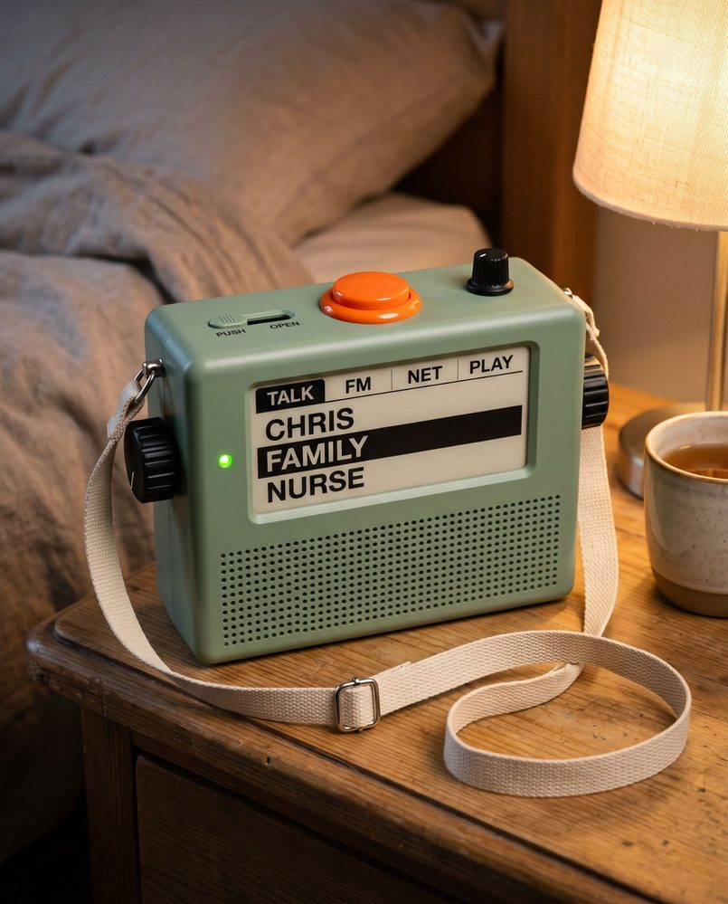
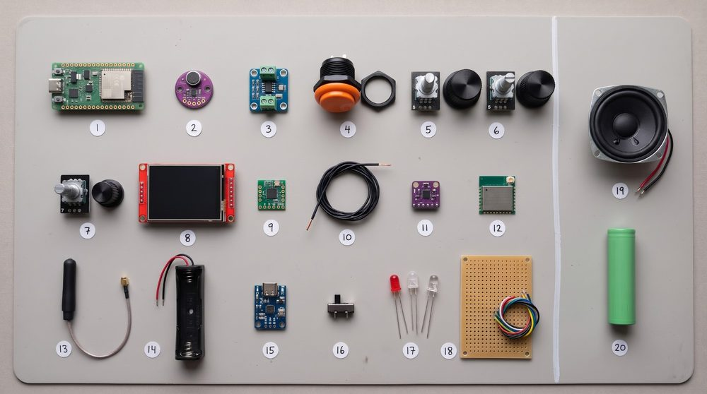
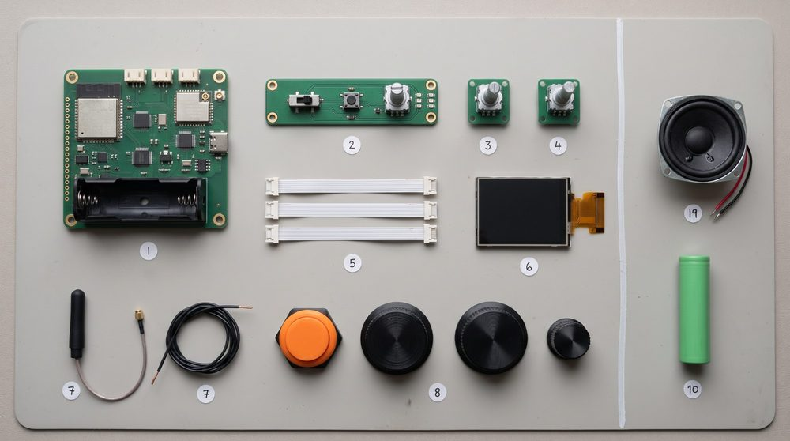
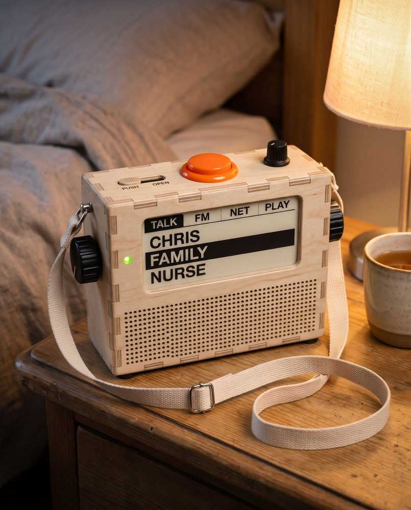

# Pop's Radio

A walkie-talkie with one big button, made for Pop.

Mobile phones can be tricky for older people. Small icons, passcodes, updates and menus get in the way when all they want is an easy way to reach the people they love. This project is a small radio that does one thing first: hold the orange button to talk, let go to listen. It works over Wi-Fi, so the family can be in the next room or the next town. A second radio inside it passes short messages from house to house when the internet is down.

**See it and try it:** https://popsradio.chrisbarlow.nz/



*Concept picture of the radio we're building. The design is [locked](docs/Design%20Decisions.md); nothing is built yet.*

The parts, built two ways:

| Wired by hand, from modules | One custom board, as a kit |
| --- | --- |
|  |  |
| Eighteen parts, about NZ$61, and two to three hours of soldering | The base is about NZ$44 each to make at 100 and NZ$33 at 1,000. No soldering. Mesh, 4G and the tilt sensor plug in as cards |

*Generated pictures, not photos of our parts. Everything right of the line is sold separately. On the site you can [tap each part](https://popsradio.chrisbarlow.nz/build.html#parts) to see what it is.*

The case comes two ways, and other shapes we looked at:

| 3D printed | Plywood | The first bedside radio | Classic handheld | Pocket pebble |
| --- | --- | --- | --- | --- |
|  |  |  |  |  |

## Where it's at

This is a family project. The design is decided, in [Design Decisions](docs/Design%20Decisions.md). The radio itself isn't built yet. Stage 1 is under way, working towards the 4 December [hack day](docs/Hack%20Day%20Action%20Plan.md), where the two R1s must talk through our own app. The R1s are ready, and the Zello fallback works. Our channel service and app aren't built yet.

| Stage | What | Status |
| --- | --- | --- |
| 1 | Prove the idea on two Rabbit R1s, reflashed to run one app | Now. Done: both R1s reflashed and rooted, the side button as push-to-talk, the Zello fallback, and the protocol spec v0.1 draft. To do before the hack day: the channel service, the app skeleton and a dry run |
| 2a | Build the radio from modules: three knobs, a 2.4 inch screen, FM and the mesh radio, about NZ$61 in parts | Next |
| 2b | Put it on one custom board that opens up for plug-in cards: 10 boards, then 100 base kits at about NZ$44 each to make | After 2a |
| 3 | A family app for iOS and Android, to talk to Pop's radio from a phone | Later |
| 4 | A direct path between homes, only if the trials show it's needed | If needed |
| Later | Certify it, then built radios and a batch of 1,000 base kits at about NZ$33 each to make | After the first 100 |
| Later | A kids' mini phone: a smaller, cheaper radio that only reaches the people parents approve | Idea |
| Later | Approved apps from other people, on the [platform](docs/Pop's%20Radio%20as%20a%20Platform.md) | Idea |

Every stage uses the same serverless service, the same code core and the same sounds, so R1s, ESP32 radios and phones can share a channel. The design is locked in the [service design](docs/Walkie-Talkie%20Service%20Design.md).

### Making the R1 work count

The R1 is a temporary client. Most of what Stage 1 builds is used again in Stage 2:

- **Used again as is:** the serverless service, the update system, the protocol, the sounds and screen states, and everything learned from the week with Pop.
- **Written once for all:** a small C library holding the protocol, encryption, jitter buffer, turn-taking and speech shaping (making voices clearer for older ears). The R1 app calls it, the ESP32 firmware compiles the same files, and the iOS and Android family app will use it too. The R1 app itself becomes the start of the Android family app.
- **Built first:** a written protocol spec and a laptop test client, so the server can be tested without either device and the two devices can be checked against each other.
- **R1 only, kept small:** reflashing, the button remap and locking the R1 to one app.

Afterwards the R1s can stay on the same channels as the ESP32 radios. The detail is in the [R1 doc](docs/Rabbit%20R1%20Walkie-Talkie%20Research%20and%20Design.md#making-the-r1-work-count-for-stage-2).

## How it works

- **Hold to talk.** One talker at a time, like a real radio. A chirp says it's ready, a roger beep says the message ended.
- **A knob picks who.** The right-hand knob says each name out loud. A channel can be one person or a group, such as the whole family.
- **More than talk.** The left-hand knob picks what the radio is doing: Talk, FM radio, internet radio, or games and a chess clock. The family chooses which appear. Holding the orange button always talks.
- **PUSH / OPEN switch.** Flip to OPEN to talk hands-free, taking turns. It works on group channels too, and the radio says out loud who can hear. The red light stays on whenever the microphone can hear. This part is a design proposal and hasn't been tested.
- **Opens up.** Take the back off and there are sockets for plug-in cards and sensors, with no soldering. It is the radio Pop's younger self would have opened. See the [tinkerer's page](https://popsradio.chrisbarlow.nz/tinker.html).
- **A mesh that is always on.** Every built radio carries a small Meshtastic radio that needs no internet. Radios in range pass short text messages along, so a message can cross a suburb in a power cut. It is connectivity, not a mode: there is nothing for Pop to do. Text only, and best efforts.
- **Up and about.** If Pop agrees, his radio tells the family when it has first been used each day, and theirs tell him. It never listens, and it is not an alarm.
- **Private.** Messages are encrypted on the radio. The server passes them on but can't open them, and nobody can switch the microphone on from somewhere else.
- **Looks after itself.** It keeps the last message for 24 hours, tells the family if it goes offline or the battery runs low, and updates itself overnight.
- **No subscription, ever.** Each set comes with its channels, and their running costs are prepaid for life. More channels can be added later, for life or monthly.

It is not an emergency alarm. In an emergency, call 111.


*How the mesh might look. A drawing, not a coverage map.*

## What's in this repo

| Folder | What's in it |
| --- | --- |
| The top level | The site (`index.html`, `tinker.html`, `build.html`, `site.css`), this README and the licences. The site files stay here so GitHub Pages can serve them |
| [`docs/`](docs) | The design: decisions, the platform brief, the service design, the hardware research and the hack day plan |
| [`reports/`](reports) | Research reports, each answering one question |
| [`research_notes/`](research_notes) | The working notes behind two of the reports |
| [`prompts/`](prompts) | The prompts used to make the pictures |
| [`images/`](images) | The pictures and drawings |
| [`models/`](models) | 3D models of the radio: the Blender file and an STL export |
| [`tools/`](tools) | Scripts for the build. `tools/r1/` backs up, unlocks, reflashes and roots the R1s, remaps the side button, sets up a home screen, and shows progress live |

| File | What it is |
| --- | --- |
| [`index.html`](index.html) | The project site. Includes a simulator you can try in the browser |
| [`tinker.html`](tinker.html) | The site's page for tinkerers: opening the radio up, the sockets, the cards, and what it can and can't do |
| [`build.html`](build.html) | The site's second page: the board, the parts, the costs, kits, the mesh and the other shapes |
| [Design Decisions](docs/Design%20Decisions.md) | What is locked: the radio, the custom board, the always-on mesh, and kits or built radios. Start here |
| [Rabbit R1 Walkie-Talkie Research and Design](docs/Rabbit%20R1%20Walkie-Talkie%20Research%20and%20Design.md) | Stage 1: the R1 hardware, reflashing, the app, networking, and designing for Pop |
| [Walkie-Talkie Beyond the R1: Minimum Hardware](docs/Walkie-Talkie%20Beyond%20the%20R1%20Minimum%20Hardware.md) | The ESP32 research behind Stage 2: the simpler one-knob build, pairing, power, and open channel mode |
| [Walkie-Talkie Service Design](docs/Walkie-Talkie%20Service%20Design.md) | The locked design: serverless service, updates, shared code, family app, lifetime costs, the guarantee and the roadmap |
| [R1 Flashing Runbook](docs/R1%20Flashing%20Runbook.md) | Step by step from stock R1 to rooted LineageOS on a Linux laptop: backup, unlock, flashing, Magisk, the side button as push-to-talk and a home screen. Done on both R1s, with what went wrong and the fixes |
| [R1 Zello Smoke Test](docs/R1%20Zello%20Smoke%20Test.md) | The hack-day fallback (not our app), and it works: both R1s talk over Wi-Fi through Zello, with the side button as the talk button, about 0.5 s delay |
| [Protocol](docs/protocol.md) | The walkie-talkie protocol spec, v0.1 draft: the WebSocket messages and the audio frame shared by R1s, ESP32 radios and phones |
| [Hack Day Action Plan](docs/Hack%20Day%20Action%20Plan.md) | Getting the two R1s talking at the 4 December hack day: what to do beforehand, and how to spend the day |
| [Walkie talkie without central relay](reports/Walkie%20talkie%20without%20central%20relay.md) | Research on running without a central relay, and the recommendation adopted |
| [NZ addressable market and opportunities](reports/NZ%20addressable%20market%20and%20opportunities.md) | Research on the size of the New Zealand market, for families and for rest homes, hospitals and other organisations, by category and region |
| [Similar products and competitors](reports/Similar%20products%20and%20competitors.md) | Research on products like Pop's Radio around the world, what they cost, and what that means for the plan |
| [Custom PCB and cost-down](reports/Custom%20PCB%20and%20cost-down.md) | Research on putting the whole platform radio, with Meshtastic, on one custom board: parts, costs at 100 and 1,000, the base kit and certification |
| [Modular platform and base unit cost](reports/Modular%20platform%20and%20base%20unit%20cost.md) | Research on a cheap base radio that opens up for plug-in modules: what works, what does not, and a revised cost of about NZ$33 a base. Accepted: decisions 13 to 23 |
| [Looking out for Pop](reports/Looking%20out%20for%20Pop.md) | Research on software and sensors that help the family look out for Pop: a daily "up and about", plug-in room sensors, what to leave out, and the rules that make it acceptable. Accepted: decisions 25 to 27 |
| [Walkie-Talkie Image Prompts](prompts/Walkie-Talkie%20Image%20Prompts.md) | Prompts for the parts pictures (every module, and the same radio on the custom board) and the earlier shapes |
| [Pop's Radio as a Platform](docs/Pop's%20Radio%20as%20a%20Platform.md) | The radio we are building: a stout radio with three free-turning knobs that also plays FM and internet radio and simple games, passes mesh messages, and could take approved apps |
| [Pop's Radio Platform Image Prompts](prompts/Pop's%20Radio%20Platform%20Image%20Prompts.md) | Prompts for concept pictures of the platform unit |
| [`images/`](images) | Concept pictures. These are generated images, not photos of real units |

## Running the site locally

The site is three HTML files and a stylesheet, with no build step. Open `index.html` in a browser, or serve the folder:

```bash
python3 -m http.server 8000
```

Then go to http://localhost:8000.

To update the progress shown on the site, change the `done` numbers in the `PLAN` object near the bottom of `index.html`.

## Licence

Free for non-commercial use. Build one for your own family, change it, share it. A home-built radio can run on your own copy of the service for free, or join ours with channels from the same [price list](docs/Walkie-Talkie%20Service%20Design.md#prices-kept-simple) as everyone else.

- **Code** (including `index.html`): [PolyForm Noncommercial 1.0.0](LICENSE)
- **Research documents and images:** [CC BY-NC-SA 4.0](https://creativecommons.org/licenses/by-nc-sa/4.0/). Credit Chris Barlow, don't use them commercially, and share any changed versions under the same licence.

The case comes two ways, 3D printed or plywood, and the plans for both will be free. Homes without Wi-Fi can plug a 4G card and a SIM into any radio, which can then share its connection as a small Wi-Fi hotspot.

Building or selling radios commercially needs a licence. See [COMMERCIAL.md](COMMERCIAL.md).
