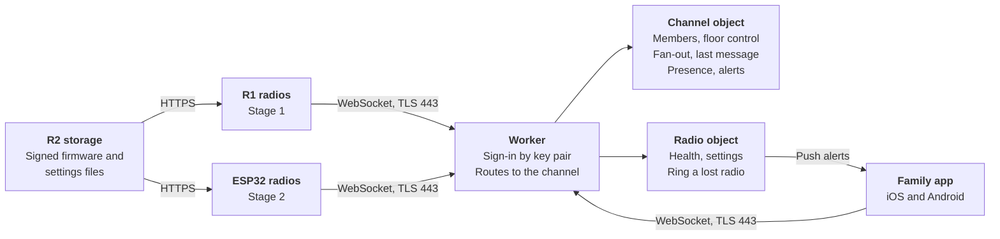

# Walkie-Talkie Service Design

Nov 15, 2026 · @Chris Barlow

## Summary

**This locks the design for Stages 1 and 2 so building can start.** The radios talk through a serverless service on Cloudflare: Workers for the front door and one Durable Object per channel to pass sealed voice between members. There is no server to run, patch or scale by hand. The service stays blind: voice is encrypted on the radio and only opened on the other radios.

- **Auto-scaling.** Every channel is its own small object, so capacity grows one channel at a time with no tuning. A Christmas-morning rush is many small channels waking up, not one big server falling over.
- **Updates.** Fully automatic and signed. Radios check nightly, install while idle on the dock, and roll back by themselves if anything goes wrong. Nobody presses anything.
- **No subscription for the hardware, ever.** Each radio's price carries a service provision of NZ$20, ring-fenced to pay its share of running costs for its whole life. Estimated running cost is about NZ$0.70 a radio a year.
- **Works anywhere.** Any internet connection that meets the minimum requirements below, in any country Cloudflare serves.
- **Code reuse.** One small C library holds the protocol, encryption, jitter buffer and turn-taking. The R1 app, the ESP32 firmware, the laptop test client and the iOS and Android family apps all use it unchanged.
- **Build your own.** Builders get a free kit list, printable case plans and a web flasher, or buy a parts kit and case from us. To use our service they buy a connection per radio, one-off for life or monthly; or they run the published service themselves for free.
- **The family app** is a paid app with an optional small subscription. It pays for the people side of running the service (updates, support, security). The radios never depend on it being bought.

This changes three earlier choices: voice now travels over a WebSocket on port 443 instead of UDP, the relay is serverless instead of a VPS in Auckland or Sydney, and the separate control page becomes part of the family app. The [relay research](reports/Walkie%20talkie%20without%20central%20relay.md) is still the background for why a blind relay is the right core.

## Decisions

| Area | Locked for Stages 1 and 2 | Instead of |
|---|---|---|
| Service | Cloudflare Workers plus one Durable Object per channel | A Go relay on a VPS |
| Transport | Sealed Opus frames as binary messages over one WebSocket (TLS, port 443) per radio | Encrypted UDP voice with a TLS control link |
| Where a channel lives | Created near its family (location hint `oc` for New Zealand) | A server in Auckland or Sydney |
| Encryption | Unchanged: per-packet XChaCha20-Poly1305 with the channel key; readable routing header | Same |
| Identity | Every radio and every app install has its own key pair | Same |
| Settings | Relay addresses, update addresses and keys arrive as a signed settings file, never compiled in | Hard-coded relay address |
| Updates | Signed images from a static manifest on Cloudflare R2; automatic, staged, self-rolling-back | Device Owner self-update from the relay |
| Control | Family app (and a free setup mode) talking to the service API | A web admin page on the relay |
| Shared code | C library: protocol, crypto, jitter buffer, floor control, session, settings | Same idea, now also covering the phone apps |
| Direct peer-to-peer | Not in Stages 1 and 2; a later cost and latency option | Same |

## How it fits together

*Radios and apps hold one outbound connection each. Everything behind it is serverless and scales by itself.*

**The channel object** does what the relay did: checks that a sender is a member, grants the floor to one talker, fans each sealed frame out unchanged, keeps the last message for 24 hours, and tells members who is talking. It never holds the channel key. It stores a spurt as one record when the spurt ends, not one per frame, which keeps storage costs near zero.

**The radio object** holds each radio's health (battery, signal, firmware, last seen), its signed settings, and queued commands such as "ring". It sends the offline and low-battery alerts to the family app as push notifications, so there are no SMS costs.

**Sign-in.** A radio proves who it is by signing a challenge with its own key. Channel membership is a list signed by the family's owner device; the service enforces it for routing but cannot add members on its own.

**Why a WebSocket and not UDP.** It is one path that works anywhere HTTPS works, including rest homes, hospitals and guest networks that block UDP, and it runs on serverless platforms that do not accept raw UDP. The cost is head-of-line blocking: a lost packet holds up the ones behind it for a round trip. On home Wi-Fi that is rare; on mobile data it is worse. The jitter buffer grows to 60 to 100 ms to absorb it, so expect about 100 to 180 ms mouth to ear on Wi-Fi (my estimate, still to be measured). If the Stage 1 trial hears stalls, a UDP path through Cloudflare's TURN service is the planned fix (Stage 4); the packets do not change.

**Where channels live.** A Durable Object is created near the first request and does not move ([Cloudflare](https://developers.cloudflare.com/durable-objects/reference/data-location/)). Each channel is created with the location hint for its family's home region, so a New Zealand family's channel lives in Oceania. A grandchild in London still connects, with about 0.3 s more delay, which a walkie-talkie tolerates.

**Limits checked.** A Durable Object handles about 1,000 requests a second ([limits](https://developers.cloudflare.com/durable-objects/platform/limits/)); one talker sends 50 frames a second, so a channel has twenty-fold headroom. Idle connections hibernate and cost nothing.

## Auto-scaling and the Christmas rush

Workers scale per request and every channel is a separate object, so there is no capacity to plan. The risk is the moment every gifted radio switches on at once, which took down Tin Can on Christmas Day 2025 (see the relay report).

- **Set up before the box is opened.** Each radio's identity, radio object and channels are created when it is assigned to a family, not when it first powers on. Switching on is then just a connection.
- **Polite reconnects.** Radios and apps reconnect with exponential backoff and random jitter, so a Cloudflare blip does not turn into a stampede.
- **Load test.** Before launch, the laptop test client drives a simulated mass switch-on and reconnect against a test account at ten times the expected peak.

## Firmware and app updates

Updates are automatic, signed and reversible. Nobody at Grandad's house does anything.

| Step | ESP32 radio | R1 radio | Family app |
|---|---|---|---|
| Find an update | Checks a signed manifest daily at a random time, and on boot | Same manifest | App Store and Google Play |
| Download | Only on the dock, from R2 over HTTPS | Same | Store |
| Install | When idle for ten minutes, ideally overnight; reboots in about a second | Silent install as Device Owner | Store |
| Prove it works | The new firmware must reach the service and pass a self-test within five minutes, or the radio rolls back to the previous slot | Previous APK kept for reinstall | Store rollback |
| Trust | Secure Boot v2 and signed images; the signing key lives offline, not on any server | APK signature | Store signing |

**Staged rollout.** Family units first, then 5%, 25% and everyone. Radios report their version and health, and the rollout stops itself if disconnects or crashes rise.

**Old radios keep working.** The service accepts every protocol version ever shipped. A version is only retired after its radios have been updated past it, so a radio never stops talking because it missed an update.

**Recovery.** If a radio is ever stuck, the family's tech person can reflash it from a web page over USB-C, with no tools to install.

## Code reuse: one core, thin shells

The parts that must behave identically everywhere live in one C library. Each device adds only what is truly its own: audio drivers, buttons, screens and the user interface.

| Module | What it does |
|---|---|
| Packet | Wire format, versioning, routing header |
| Crypto | Sealing frames, wrapping channel keys for each member, checking signed membership and settings (libsodium) |
| Audio | Opus encode and decode with FEC, jitter buffer, packet loss concealment |
| Floor | Push-to-talk and open-mode turn-taking, busy and pre-roll rules |
| Session | Connect, sign in, join channels, heartbeats, reconnect with backoff |
| Settings and updates | Read the signed settings file and update manifest |

**Rules for the core.** Plain C, no threads, no operating system calls. The device supplies a small interface: the time, random numbers, storage, and send and receive over its own WebSocket. One CMake build produces an ESP-IDF component, an Android NDK library, an iOS framework and a desktop library, and every build runs the same test vectors in CI.

**The shells.**

| Device | Shell |
|---|---|
| R1 (Stage 1) | Kotlin Android app, "radio" build: Device Owner, kiosk, button daemon |
| ESP32 (Stage 2) | ESP-IDF firmware; xiaozhi-esp32 already speaks Opus over WebSocket, so the fork stays small |
| Android family app (Stage 3) | The same Kotlin codebase as the R1 app, "family" build |
| iOS family app (Stage 3) | Swift, with Apple's Push to Talk framework so messages arrive with the phone locked |
| Laptop test client | A small command-line program on the desktop library |
| Service | TypeScript on Workers. It only reads routing headers, and shares the core's test vectors to stay in step |

So the Android app written for the R1 in Stage 1 is the start of the Android family app, not throwaway work.

## The family app

The app lets Grandad's family talk to his radio from their phones, and gives them the setup and care tools that the control page was going to provide.

- **Talk** on any channel the phone is a member of, with the same chirps and turn-taking as the radios.
- **Join** by scanning an invite from the family's owner device. The phone gets its own key pair, and the channel key is wrapped for it; Grandad's radio needs no change.
- **Care:** battery, online status and alerts as push notifications; ring a lost radio; set volume, treble, quiet hours and knob lock; record spoken channel names.
- **Set up:** put a new radio on Wi-Fi over Bluetooth and assign its channels, replacing the laptop script for families.
- **Never:** turn a radio's microphone on, or switch a radio into OPEN. Those stay on the radio's own switch.

**Pricing.** A paid app, with an optional small subscription. One rule protects the no-subscription promise: **buying radios must never require buying the app.** So setting up and caring for radios is a free part of the app, unlocked by the code in the radio's box. Talking from the phone is what is paid for. Subscription extras could include longer message history (still end-to-end encrypted), more family phones, and text of messages produced on the phone itself. App store fees are typically 15 to 30% of the price.

**What the subscription is for.** Not the radios' running costs, which are prepaid. It funds the people side: security updates, support and new features. At an assumed NZ$30,000 a year for minimal maintenance, about 1,000 subscribers at NZ$2.99 a month cover it after store fees (my arithmetic).

## No subscription, ever: whole-of-life costs

Each radio carries a prepaid share of the service for as long as it works. The running costs are small enough that this is affordable.

**Running cost per family** (four radios, 20 minutes of talk a day, Cloudflare list prices read on 15 November 2026):

| Item | Basis | US$ a month |
|---|---|---|
| Channel object time | Active only while someone talks; doubled for set-up, tails and health checks | 0.11 |
| Voice messages | 50 frames a second while talking, billed at 20 messages to one request | 0.014 |
| Storage, alerts, firmware downloads | One record per spurt; push alerts free; R2 has no download charge | 0.005 |
| **Total** | | **about 0.13** |

That is about US$0.39, or **NZ$0.71, a radio a year** (NZ$1.81 to the US dollar). A heavy family talking an hour a day costs three times that. The fixed platform fee (US$5 a month) and domain add NZ$0.14 a radio a year at 1,000 radios and almost nothing at scale. Sources: [Durable Objects pricing](https://developers.cloudflare.com/durable-objects/platform/pricing/) and the relay report's cost table, which these figures match.

**Service provision per radio: NZ$20.** Over a 15-year life (generous for a battery device), average use costs about NZ$11. NZ$20 leaves room for heavy households, which average out across the fleet, and for price rises. The provision goes into a ring-fenced fund on every sale and is only spent on running the service.

**Unit cost build-up.** Parts NZ$35 to 50 (Stage 2 doc), plus the NZ$20 service provision, plus assembly, certification, packaging and warranty, which are not yet estimated.

**What the provision does not cover.** People. Security fixes, support and keeping up with platform changes cost more than the servers, as Signal's accounts show. Those are funded by app sales and subscriptions, and by new radio sales. At around 100,000 radios a modest maintenance budget falls under NZ$1 a radio a year and could be prepaid too; below that it depends on the app.

## The guarantee and minimum requirements

The promise: **the radio keeps working, with no subscription, anywhere in the world, as long as its internet connection meets the minimum requirements.**

**Minimum requirements.**

| Need | Radio | Family app |
|---|---|---|
| Connection | Outbound HTTPS (TCP 443) and DNS | Same |
| Speed while talking | About 64 kbit/s each way | Same |
| Delay | Round trip under about 300 ms to the nearest Cloudflare site | Same |
| Wi-Fi | 2.4 GHz, WPA2 or WPA3 Personal, or open | Any |
| Not supported | Wi-Fi with a sign-in page (hotels, some rest homes) or enterprise logins | None |

**Exceptions to state plainly.** Countries or networks that block Cloudflare or this service; places where the radio's certification does not allow sale or use (it is certified for New Zealand first); and connections below the minimum.

**What makes the guarantee real.**

- **The money is prepaid** in the ring-fenced fund, not dependent on future sales.
- **The service is replaceable.** Every radio takes its service addresses from signed settings, so it can be moved to another host by one update.
- **A published fallback.** A self-hostable version of the service is published, so a family or community can run it if we cannot.
- **An end-of-service plan.** If the business ever stops, the fund, domains, signing keys and code pass to a named trustee or community group, and the code is relicensed for free use.
- **Get the wording reviewed.** A "forever" promise is a legal commitment under the Fair Trading Act and Consumer Guarantees Act. The wording, the trust arrangement and the interception-law position (see the relay report) need a lawyer before anything is sold. Nothing here is legal advice.

## Build your own: kits, cases and connections

People who build their own radio still need the service for channels and updates. So the hardware, the case and the connection are sold separately, and each has a free option.

| Item | Do it yourself | Buy from us |
|---|---|---|
| Parts | Free kit list with part numbers and suppliers (the Stage 2 doc) | A parts kit with every part, tested to work together |
| Case | Free printable plans (STL and STEP files) | A printed case, as a separate store item |
| Firmware | Flash it from a web page over USB-C, free | Comes loaded on a kit's board |
| Connection | Run the published service yourself, free for non-commercial use | A connection for each radio: one-off for life, or monthly |

**How a connection works.** When a home-built radio is first flashed it makes its own key pair and shows or speaks a claim code. The builder buys a connection in the store or the family app and enters the code. The service then lets that radio sign in, join channels and receive updates, exactly like a radio we sold. A radio with no connection cannot sign in. Connections can be moved to a replacement radio, and a refunded or charged-back connection is switched off.

**Connection prices.** Both options cover channels and updates; the radio and the channel are identical either way.

| Option | Starting point | Basis |
|---|---|---|
| One-off, for the life of the radio | About NZ$29 including GST | The NZ$20 service provision, GST, payment fees and a contribution to maintenance. Paid into the same ring-fenced fund as sold radios, with the same guarantee |
| Monthly | About NZ$1 a radio a month, billed per family, monthly or yearly | Running costs are about 6 cents a radio a month, so most of a small monthly payment goes on payment fees; billing per family keeps that sensible. Pays back the one-off price in about two and a half years |

These are starting points to test, not decisions. The monthly option is a builder's choice; the no-subscription promise for radios we sell is unchanged.

**Updates on home-built boards.** Official firmware is signed and checked by the radio before it installs, as on our units. Builders' boards do not have Secure Boot switched on, because that permanently locks the chip to our key; the signature check still runs in the firmware. Updates are published per supported board, so the kit list names the boards and pin layouts the firmware supports. Other boards work with the free self-hosted option and builders' own firmware.

**Licences.** Building a radio for your own family, printing your own case and running your own copy of the service are non-commercial use and free. Buying a connection does not change that. Anyone else selling kits, cases or connections needs a commercial licence ([COMMERCIAL.md](COMMERCIAL.md)). Case plans are released under the same CC BY-NC-SA licence as the documents.

## Roadmap

| Stage | What | Notes |
|---|---|---|
| 1, now | Two R1s on the serverless service | Protocol spec, C core, laptop test client, channel service, R1 "radio" app, a week with Grandad |
| 2, next | Our own ESP32 radio | Firmware on the C core, signed automatic updates, setup over USB then Bluetooth, power, case |
| 3 | Family app for iOS and Android | Talk, join, care and setup. Android starts from the R1 app's codebase |
| 4, if measured | Direct path | Peer-to-peer and a UDP path through TURN, only if trial data shows cost or delay needs it |
| Later | Kids' mini phone | Below |

**Kids' mini phone (later).** A smaller, cheaper unit built from the same parts for children, who can only reach the people their parents approve, like an old home phone. It uses the same service, C core, update system and no-subscription rule, and parents manage contacts from the family app. Tin Can's kids' landline shows the demand, and its Christmas outage shows why the scaling work comes first. A product for children brings extra duties: no strangers, ever; privacy rules for children's data; and toy and battery safety standards. Not started; noted so Stages 1 to 3 do not close the door on it.

## Risks

| Risk | Impact | Mitigation |
|---|---|---|
| Cloudflare changes prices or terms | Running cost rises | Margin in the provision; signed settings let the service move; published self-host version |
| TCP stalls on poor links | Choppy audio | Larger jitter buffer; measure in Stage 1; TURN path in Stage 4 |
| Bad firmware reaches radios | Radios offline | Staged rollout with auto-stop, self-test and rollback, USB recovery |
| Signing key stolen | Malicious firmware | Key kept offline; Secure Boot; key rotation plan |
| "Forever" promise outlives the business | Broken promise | Prepaid fund, trustee, published code |
| App revenue too low | Maintenance underfunded | Radios still run on the prepaid fund; maintenance scaled back, not the service |
| Christmas rush | Set-up fails | Pre-provisioning, backoff, load test at ten times the peak |
| Durable Object estimates wrong | Costs differ | Measure real cost per family in the Stage 1 trial before setting the provision |

**Still to confirm:** real cost per family from the trial, mouth-to-ear delay over WebSocket on the R1 and ESP32, the Apple Push to Talk entitlement, and legal review of the guarantee.
