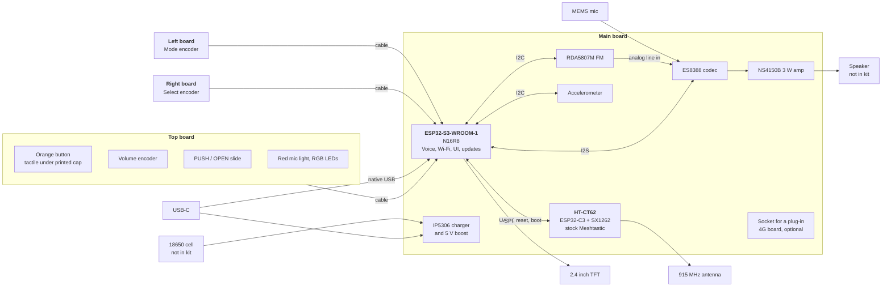

# One custom board makes the full radio, Meshtastic included, about NZ$45 a kit

Nov 16, 2026 · @Chris Barlow

> **Decided on 16 November 2026.** The custom board, option C for the mesh, and the kit are now the plan, and the mesh is **always on, with every radio passing messages along**. That last choice goes further than this report first recommended; the settings and power notes below are updated to match. See [Design Decisions](../Design%20Decisions.md). Later the same day, LTE was also decided: it moves from a footprint on the main board to a plug-in 4G board, so any radio can take one (decision 12).

## Summary

**A custom board is worth doing, but mostly for labour, reliability and volume, not because the parts get much cheaper.** The full platform radio (three knobs, bigger screen, FM, tilt sensor, battery, Wi-Fi voice and now Meshtastic) costs about **NZ$61 to 103 in modules** before shell, speaker and battery cell, plus two to three hours of wiring. On one custom board, assembled and tested in China, the same radio comes to about:

| Batch | Parts | Board and assembly | Freight | Landed, NZ$ incl. GST |
|---|---|---|---|---|
| 100 kits | US$22.84 | US$4.20 | US$1.00 | **about NZ$58** |
| 1,000 kits | US$18.41 | US$2.70 | US$0.40 | **about NZ$45** |

That is everything in the [platform brief](../Pop's%20Radio%20as%20a%20Platform.md) for about the price the Stage 2 doc gives for the one-knob radio (NZ$35 to 50), with no wiring at all.

- **Meshtastic: add it as a co-processor, not as code in our firmware.** A Heltec HT-CT62 stamp (ESP32-C3 plus SX1262, US$6.90) runs stock Meshtastic beside the ESP32-S3, linked by a serial line. It keeps the mesh on even while voice runs, keeps GPL code out of our PolyForm firmware, needs no Meshtastic changes, and the S3 can update it. It is also the single dearest part on the board, about 30% of the parts bill.
- **Base kit:** every board assembled and tested, the screen, cables, the 915 MHz and FM antennas and a battery holder. Not included: shell, speaker, and the battery cell, which is cheaper and easier to buy in New Zealand than to air-freight. Suggested price **NZ$89 to 99** for the first 100, falling towards **NZ$79** at 1,000.
- **One board, several radios.** Leave parts off the same board for a talk-only radio (about NZ$25 landed at 1,000), fit the LTE footprint for homes with no Wi-Fi, or build the kids' mini phone without the mesh.
- **The biggest cost is not a part.** Certifying the radio for sale is about US$3,000 to 8,000 with pre-certified modules. Across 100 kits that is NZ$54 to 145 each; across 1,000 it is NZ$5 to 15. Sell the first batch as a trial and certify before selling at volume.
- **The biggest levers:** buy 1,000 not 100 (saves about NZ$13 a kit), keep an ordinary TFT screen rather than a memory LCD (saves about NZ$31), make the orange button a printed cap over a NZ 5-cent switch, use generic encoders after Pop has tried them, and leave the battery cell out of the kit.

Prices are LCSC, JLCPCB and maker list prices read on 16 November 2026 unless marked, converted at NZ$1.81 to the US dollar to match the rest of the repo (the market rate was 0.5539, or NZ$1.805, on 6 November; [TMGM](https://www.tmgm.com/en-eu/analysis/market-news/article/05540-new-zealand-dollar-dips-to-19-month-lows-ahead-nfp-numbers-202611061216)). Many volume prices are LCSC "from" prices, which are their largest quantity break. Lines marked *estimate* are mine, not quotes. Nothing here has been quoted end to end; the next step is a real BOM upload to JLCPCB.

## What is being costed

"The current Pop's Radio" here means the platform unit with every feature and idea in the repo, plus Meshtastic. Each feature needs a part.

| Feature or idea | Where it comes from | Part on the custom board |
|---|---|---|
| Hold to talk, Opus over Wi-Fi, signed updates | [Stage 2](../Walkie-Talkie%20Beyond%20the%20R1%20Minimum%20Hardware.md), [service design](../Walkie-Talkie%20Service%20Design.md) | ESP32-S3 module, 16 MB flash, 8 MB PSRAM |
| Mic, speech shaping, loud speaker | Stage 2 | Audio codec, analog MEMS mic, 3 W class-D amp on a 5 V rail |
| PUSH / OPEN slide switch, red mic light | Stage 2, platform | Slide switch, red LED wired so it lights whenever the mic is powered |
| Orange button, tap or hold | Platform | Tactile switch under a printed cap |
| Volume, Mode and Select knobs, free turning with push | Platform | Three EC11 encoders with switch |
| Larger screen, readable at night, fast enough for Pong | Platform | 2.4 inch 320 × 240 TFT, dimmable backlight |
| FM radio with antenna in the strap | Platform | RDA5807M FM receiver, wire antenna connector |
| Internet radio | Platform | Nothing extra: Wi-Fi and the codec |
| Lie on its back for games | Platform | Accelerometer |
| Shoulder strap, so it leaves the dock | Platform | 18650 cell holder, charger with power path, boost to 5 V |
| Status colours | Stage 2 | Two RGB LEDs |
| Setup over USB, web flasher recovery | Service design | USB-C straight to the S3's own USB |
| LTE for homes without Wi-Fi | Stage 2 | Footprint for an A7670G modem, left empty by default |
| Kids' mini phone | Service design | Same board, parts left off |
| **Meshtastic** | This report | HT-CT62 co-processor and 915 MHz antenna |

## What it costs from modules today

The platform brief says its hardware is "not priced yet". Priced the Stage 2 way, from breakout boards, it comes to about NZ$47 before the mesh, the cell, the shell and the speaker.

| Part | NZ$ incl. GST | Basis |
|---|---|---|
| ESP32-S3 dev board, N16R8 | 10 | Stage 2 doc |
| I2S mic and MAX98357A breakouts | 6 | Stage 2 doc |
| Three encoder modules | 7.50 | Stage 2 doc, NZ$2 to 3 each |
| 2.4 inch TFT | 8 | LCSC single price, US$3.78 (*estimate* for a module) |
| FM module | 2 | Electrodragon, US$0.80, plus freight |
| Accelerometer breakout | 2 | *estimate* |
| Charger board, 18650 holder | 3.20 | Surplustronics prices in Stage 2 doc |
| Big button, slide switch, LEDs | 5 | Stage 2 doc and *estimate* |
| Proto board and wire | 3 | *estimate* |
| **Subtotal** | **about 47** | |
| Meshtastic, as a bare HT-CT62 stamp | 14 | US$6.90 ([Heltec](https://heltec.org/product-category/module-element)) |
| Meshtastic, as a Heltec V3 board | 56 | US$26.97 ([Rokland](https://store.rokland.com/products/heltec-wifi-lora-32v3)) |
| **With Meshtastic** | **about 61 to 103** | |

Add two to three hours of soldering and wiring per radio (*estimate*), which is the real cost of the module route and why it does not scale past a family build.

## The custom board

### Architecture

*One main board and three small boards, all cut from one panel and assembled in one order.*

**Why four boards from one panel.** The case is 220 mm wide with knobs on the left side, the right side and the top. One board cannot put an encoder on three faces. Four boards joined by short cables can, and if they are cut from the same panel they share one set of setup and stencil fees. The battery holder sits at the bottom edge of the main board, so the weight stays low as the brief asks.

### Part choices

| Block | Choice | Price, US$ | Why this one | Cheaper or dearer option |
|---|---|---|---|---|
| Main chip | ESP32-S3-WROOM-1-N16R8 | 3.78 at 100, 3.55 at 1,300 ([LCSC](https://www.lcsc.com/product-detail/C2913202.html)) | Pre-certified module, same chip as Stage 2. Out of stock at LCSC on 16 Nov | Bare ESP32-S3 chip saves about US$0.50 (*estimate*) but loses the module's radio approval |
| Mesh | Heltec HT-CT62 | 6.90 single ([Heltec](https://heltec.org/product-category/module-element)); 5.50 at 1,000 (*estimate*) | Runs stock Meshtastic, 21 dBm, IPEX antenna socket, about 10 µA asleep ([Meshtastic](https://meshtastic.org/docs/hardware/devices/heltec-automation/ht62/)) | See [Meshtastic](#meshtastic) |
| Codec | ES8388 | from 0.56 ([LCSC](https://www.lcsc.com/product-detail/C365736.html)) | Two inputs, so mic and FM share one chip, and an analog bypass so FM plays without the S3 moving the audio | ES8311 from 0.24 ([LCSC](https://www.lcsc.com/product-detail/C962342.html)) if FM goes digital (below) |
| Amp | NS4150B, 3 W | from 0.07 ([LCSC](https://lcsc.com/product-detail/Audio-Amplifiers_Shenzhen-Nsiway-Tech-NS4150B_C189961.html)) | Analog input to suit the codec. Runs from the 5 V boost, so full volume on battery too | NS4168 I2S amp, 2.5 W into 4 ohms at 5 V, from 0.37 ([LCSC](https://www.lcsc.com/product-detail/C910588.html)) |
| Mic | ZTS6117 analog MEMS | from 0.09 ([LCSC](https://www.lcsc.com/product-detail/C481300.html)) | Feeds the codec, a tenth of an INMP441 breakout | |
| FM | RDA5807M module | 0.80 ([Electrodragon](https://electrodragon.com/?p=10980)) | Castellated module solders flat; the chip is not stocked at LCSC | RDA5807FP lists I2S ([JLCPCB](https://jlcpcb.com/partdetail/RdaMicroelectronics-RDA5807FP/C77689)), which pairs with the ES8311 |
| Tilt | LIS2DH12 | from 0.50 ([LCSC](https://lcsc.com/product-detail/C110926.html)) | In stock, well supported | SC7A20 from 0.19, out of stock ([LCSC](https://www.lcsc.com/product-detail/C5126709.html)) |
| Screen | 2.4 inch ST7789 TFT, 320 × 240, SPI | 2.57 at 100, 2.35 at 1,000 ([LCSC](https://www.lcsc.com/product-detail/C5329583.html)) | Fast enough for Pong, readable at night, PWM backlight for the bedside | Sharp memory LCD 2.7 inch from 17.18, out of stock ([LCSC](https://www.lcsc.com/product-detail/C17492463.html)) |
| Knobs | EC11 encoder with push, ×3 | ALPS 1.10 at 120+ ([LCSC](https://fat.lcsc.com/product-detail/Rotary-Encoders_ALPSALPINE-EC11E1834403_C361165.html)); generic 0.38 at 2,000+ ([Alibaba](https://www.alibaba.co.uk/product-detail/New-EC11-Rotary-Encoder-11mm-5_1601845637930.html)) | ALPS for the first 100; generic once Pop has tried both | |
| Power | IP5306-I2C | from 0.17 ([LCSC](https://www.lcsc.com/product-detail/C488349.html)) | Charger, power path and 5 V boost in one chip, so it runs on the dock and charges at once | TP4056 without power path is cheaper but wrong for a radio that lives on a dock |
| Cell holder | BH-18650, SMT | from 0.94 ([LCSC](https://www.lcsc.com/product-detail/C2988620.html)) | Cell bought locally | |
| Other | USB-C, ESD, tactile and slide switches, LEDs, cables, passives | about 2.70 at 1,000 (*estimate*) | | |
| Antennas | 915 MHz whip with pigtail; FM wire | about 1.20 (*estimate*) | | |
| LTE, optional | A7670G | from 12.30 ([LCSC](https://www.lcsc.com/product-detail/C5846957.html)) | Decided later: on a plug-in 4G board with its SIM holder and antenna; a socket on every main board | |

**On the audio.** The Stage 2 doc found the MAX98357A gives only about 0.9 W from a bare battery. Here the amp runs from the IP5306's 5 V boost, so the radio is as loud off the dock as on it. The ES8388 also has a spare ADC path that can carry an echo reference later, which keeps the door open for true two-way OPEN mode.

**On the screen.** A memory LCD would cost about seven times the TFT and is out of stock. Take the TFT now and test it in daylight; the [platform brief](../Pop's%20Radio%20as%20a%20Platform.md#the-screen-an-open-question) question is still open, but the board only needs an SPI connector, so a different panel can be swapped in later.

## Meshtastic

### What it gives Pop

Meshtastic is a text mesh, not a voice link. The [relay report](Walkie%20talkie%20without%20central%20relay.md#radio-mesh-cannot-carry-pops-voice-to-the-next-town) already showed it cannot carry live voice between towns. On Pop's radio it is a second path for short messages that works with no internet and no power at the house.

- **Outage messages.** When the internet or the power is down, family on Meshtastic can send a short text. It shows in large type with a chime.
- **"I'm OK" without the internet.** *Not taken as written: the mesh is connectivity, not a mode, so there is no Mesh position on the Mode knob and nothing for Pop to do.* The first idea was a Mesh mode on the Mode knob, switched on by the family, where Select picks a canned message and a press sends it. The orange button stays talk only, as the platform rules require.
- **A stronger local mesh.** Every Pop's Radio is an always-on node that passes messages along, so each one sold adds a link. Wellington's mesh is already busy (see the relay report), so talk to the local mesh group before a large batch ships there.
- **Later: voice clips, not live voice.** Projects such as Voicetastic send whole voice clips on Meshtastic's private-app port 256 ([Voicetastic](https://github.com/voicetastic/voicetastic-core/wiki/Overview)). The relay report puts a 10-second clip at about 15 seconds per hop. Possible as a voicemail, never as the main channel.

### Three ways to add it

| | A. Shared radio | B. Meshtastic code in our firmware | C. Co-processor (recommended) |
|---|---|---|---|
| Hardware | SX1262 module on the S3's SPI bus | Same as A | HT-CT62 beside the S3 |
| Extra parts, 1,000 | about US$3 (HT-RA62 is US$3.90 single) | about US$3 | about US$5.50 |
| Mesh while talking | No. The S3 boots into Meshtastic or into Pop's firmware, not both | Yes | Yes |
| Firmware licence | Meshtastic is GPL-3.0; a separate image is fine | Combines GPL-3.0 code with PolyForm Noncommercial, so the firmware would have to be GPL | Stock Meshtastic on its own chip; our firmware stays ours |
| Meshtastic changes | New board variant to write and keep up | A fork to keep up | None: the HT-CT62 already has an official build |
| Updates | Two images on one chip; fiddly partitions | One image | S3 flashes the C3 with Espressif's esp-serial-flasher (Apache-2.0), which supports an ESP32 host and an ESP32-C3 target ([Espressif](https://components.espressif.com/components/espressif/esp-serial-flasher/versions/1.11.0/readme)) |
| Verdict | Cheapest, but not really "supporting" Meshtastic | Only if the firmware is relicensed | **Recommended** |

Meshtastic's firmware is GPL-3.0 ([JKPG Mesh](https://jkpg-mesh.github.io/blogs/blog9.html)), and so are its protobuf definitions ([GitHub](https://www.github.com/meshtastic/protobufs)). That shapes the link between the two chips:

- **Start with TEXTMSG mode.** Meshtastic's serial module can send each line it receives as a text on the primary channel and print incoming texts as `<ShortName>: <text>` ([Meshtastic](https://meshtastic.org/docs/configuration/module/serial/)). Our firmware parses plain text and links no Meshtastic code.
- **PROTO mode later, after advice.** The full protobuf API is needed for direct messages, telemetry and voice clips. Whether code generated from GPL protobufs makes our firmware a GPL work is a question for a lawyer, not this report.
- **Shipping Meshtastic.** We distribute an unmodified GPL binary, so the kit must point to the matching source.

### Settings for a family radio

| Setting | Value | Why |
|---|---|---|
| Region | ANZ, 915 to 928 MHz | Meshtastic's ANZ region allows 100% duty cycle and 30 dBm ([Meshtastic](https://meshtastic.org/docs/configuration/radio/lora)); the NZ licence allows up to 1 W EIRP (relay report) |
| Primary channel | The family's own channel with its own key | TEXTMSG uses the primary channel, so strangers on the public channel never reach Pop's screen |
| Role | Client: passes messages along | Decided: every Pop's Radio is a link in the mesh. This adds load in a busy city, so match the local mesh's settings and keep the default hop limit of 3 |
| Preset | Match the local mesh | Wellington moved off LongFast in 2024 |
| Bluetooth on the C3 | Off | One less radio and one less thing to pair; set up over the S3 instead |
| Name | A nickname, not Pop's real name | Node names are public |
| Power | Always on, on the dock and on battery | Decided. A sleeping radio is a gap in the mesh. See below |

**Power.** With the mesh off, a 3000 mAh 18650 would last about 13 days at 5 mA standby and 20 minutes of talk a day (my arithmetic, 80% usable, as in the Stage 2 doc). With the mesh drawing about 30 mA (*estimate*), it lasts under 3 days. The decision is to keep the mesh on all the time and accept about 3 days off the dock. The radio lives on its dock, so this mostly matters in a power cut, and three days on a fully charged radio covers most outages. An earlier draft of this report switched the mesh on only when docked or when Wi-Fi was down; that saves battery but leaves gaps in the mesh for everyone else.

**Rules that carry over.** The HT-CT62 has no wire to the microphone, so "nobody can switch the microphone on from somewhere else" stays true in hardware. The kids' mini phone leaves the HT-CT62 off the board: an open mesh breaks "no strangers, ever".

**The name.** Meshtastic's trademark policy says third-party products may not use its marks in primary or secondary branding, and putting the logo on hardware needs written permission from its trademark supervisor ([Meshtastic](https://meshtastic.org/docs/legal/licensing-and-trademark/)). Call the feature "Mesh", say in the docs that it works with Meshtastic, and ask trademark@meshtastic.org before using the logo.

## The cost model

### Parts per kit

| Part | 100 kits, US$ | 1,000 kits, US$ |
|---|---|---|
| ESP32-S3-WROOM-1-N16R8 | 3.78 | 3.55 |
| HT-CT62 Meshtastic co-processor | 6.90 | 5.50 |
| ES8388 codec, NS4150B amp, ZTS6117 mic | 0.87 | 0.72 |
| RDA5807M FM module | 0.80 | 0.80 |
| LIS2DH12 accelerometer | 0.55 | 0.50 |
| 2.4 inch TFT | 2.57 | 2.35 |
| Three encoders (ALPS at 100, generic at 1,000) | 3.30 | 1.14 |
| Talk switch, slide switch, LEDs | 0.20 | 0.20 |
| Power: IP5306-I2C, inductor, regulator, cell protection | 0.35 | 0.31 |
| USB-C and ESD | 0.12 | 0.10 |
| 18650 holder | 1.00 | 0.94 |
| Antennas | 1.20 | 1.20 |
| Board-to-board cables | 0.30 | 0.30 |
| Passives and small parts | 0.90 | 0.80 |
| **Parts** | **22.84** | **18.41** |

Prices at 100 are from LCSC tiers where shown, and otherwise LCSC "from" prices plus about 15% (*estimate*). Generic encoders have a 2,000 minimum, which 1,000 kits of three meets.

### Board and assembly

JLCPCB's assembly price page, updated 22 October 2026, lists these fees ([JLCPCB](https://jlcpcb.com/help/article/pcb-assembly-price)):

| Fee | Standard assembly |
|---|---|
| Setup | US$25.56 one side, US$51.12 both sides |
| Stencil | US$8.21 one side |
| Machine placement | US$0.0016 a joint, US$0.0013 above 50,000 joints |
| Hand soldering | US$0.0164 a joint, plus US$3.58 an order |
| Loading each extended part | US$1.53 |

The panel holds about 700 machine joints and 30 hand-soldered ones (encoders and holder) per kit (*estimate*). Four-layer board was US$106.30 for 100 boards of 100 × 100 mm in JLCPCB's March 2024 example ([JLCPCB](https://jlcpcb.com/blog/special-discount-on-quality-4-layers-pcbs)), and its August 2026 price change removed surcharges on large orders rather than raising prices ([JLCPCB](https://jlcpcb.com/news/jlcpcb-fr4-pcb-price-adjustment-august2026)). Allowing for a 130 × 100 mm panel:

| | 100 kits | 1,000 kits |
|---|---|---|
| Board | 1.40 | 1.00 |
| Machine and hand joints | 1.61 | 1.40 |
| Order fees (setup, stencil, about 20 extended parts, fixtures), spread | 0.95 | 0.10 |
| Margin for things missed | 0.24 | 0.20 |
| **Board and assembly, US$ per kit** | **4.20** | **2.70** |

### Landed in New Zealand

| | 100 kits | 1,000 kits |
|---|---|---|
| Parts | 22.84 | 18.41 |
| Board and assembly | 4.20 | 2.70 |
| Courier from Shenzhen (*estimate*) | 1.00 | 0.40 |
| **US$ per kit** | **28.04** | **21.51** |
| NZ$ before GST | 50.75 | 38.93 |
| **NZ$ incl. 15% GST** | **58.37** | **44.77** |

A shipment over NZ$1,000 pays GST at the border plus Customs and MPI levies, which changed on 1 April 2026 ([Customs](https://www.customs.govt.nz/business/goods-levies/goods-levies-2026-changes)), and a broker's fee. Budget NZ$100 to 200 a shipment (*estimate*). Not included: flashing and testing in New Zealand, packaging, and the shell, speaker and cell.

### Against the module build

| Build | NZ$ incl. GST, before shell, speaker and cell | Wiring time |
|---|---|---|
| Modules, mesh on a bare HT-CT62 | about 61 | 2 to 3 hours |
| Modules, mesh on a Heltec V3 | about 103 | 2 to 3 hours |
| Custom board, 100 kits | about 58 | None |
| Custom board, 1,000 kits | about 45 | None |

At 100 kits the custom board matches the cheapest module build on parts and wins on time and reliability. At 1,000 it is about a quarter cheaper than the cheapest module build and less than half the Heltec route.

## The base kit

**In the box:** main, top, left and right boards, assembled and tested with firmware loaded; the 2.4 inch screen; the board-to-board cables; a 915 MHz antenna with pigtail; an FM wire for the strap; an empty 18650 holder on the board; a printed card for setup.

**Not in the box:** the shell and knob caps (printable plans are free, or bought printed), the speaker (a 40 mm 4 ohm unit is US$3.96 at 100 from [Adafruit](https://www.adafruit.com/product/3968); bigger is better for music), and the 18650 cell. An LG HG2 is NZ$12.50 a cell in a pair from [PB Tech](https://www.pbtech.co.nz/product/NBBOEM1865004/OEM-Pack-2pcs-18650-Li-ion-Battery-Flat-Top-3000mA) and is unprotected, so the board carries its own protection. Cells are awkward to air-freight, so leaving them out avoids dangerous-goods freight.

**Channels are separate.** The [service design](../Walkie-Talkie%20Service%20Design.md#build-your-own) already says builders use the same channel price list or run the service themselves.

**Suggested price.** Gross margin per kit before certification, packaging, payment fees and support:

| Price incl. GST | 100 kits | 1,000 kits |
|---|---|---|
| NZ$79 | NZ$18 (26%) | NZ$30 (43%) |
| NZ$89 | NZ$27 (34%) | NZ$39 (50%) |
| NZ$99 | NZ$35 (41%) | NZ$47 (55%) |

NZ$89 to 99 suits a first batch; NZ$79 becomes possible at 1,000. For scale, a Heltec V3 Meshtastic board alone is about NZ$56 before freight and a LilyGO T-Embed NZ$93 to 113 (Stage 2 doc), and neither is a radio Pop can use.

### Other radios from the same board

| Version | Leave off | Add | Parts, US$ at 1,000 | Landed NZ$ incl. GST |
|---|---|---|---|---|
| Platform with mesh (base kit) | Nothing | | 18.41 | about 45 |
| Platform without mesh | HT-CT62, 915 MHz antenna | | 11.76 | about 31 |
| Talk only, one knob | Mesh, FM, tilt, side boards | | 9.25 | about 25 |
| LTE | | A7670G and a SIM holder | about 31 | about 71 |
| Kids' mini phone | Mesh, FM, tilt | Smaller shell | about 9 to 12 (*estimate*) | about 25 to 31 |

All versions run the same firmware, which reads which parts are fitted at boot.

## Cost-down levers, ranked

| Lever | Saves per kit | Trade-off |
|---|---|---|
| Order 1,000, not 100 | about NZ$13.60 | Cash up front; stock to hold |
| Keep the TFT instead of a memory LCD | about NZ$31 | Glows, weaker in daylight. Test with Pop |
| Leave the cell out of the kit | about NZ$12.50 | One more thing for the builder to buy |
| Mesh as an option, not standard | about NZ$14 | Fewer radios on the mesh. Not taken: the mesh is standard |
| Shared radio instead of co-processor (option A) | about NZ$5 | No mesh while talking; dual-image firmware |
| Generic encoders instead of ALPS | about NZ$4.30 | Feel and life unproven. Let Pop try both |
| Printed cap over a tactile switch instead of an arcade button | about NZ$2.40 | Feel to be tried with Pop |
| Bare SX1262 chip instead of a radio module (option A only) | about NZ$1.50 (*estimate*) | Loses the module's approvals; full radio testing (see below) |
| Bare ESP32-S3 chip instead of a module | about NZ$1 (*estimate*) | Same as above, and an antenna to design |
| JLCPCB basic parts wherever possible | US$1.53 an extended part an order | Narrower choice |
| Economic assembly for prototypes | Setup US$8.18 instead of US$25.56 | One side only, fewer parts |

## Certification

A radio sold in New Zealand needs a supplier's declaration of conformity for each product or significant variant, signed by someone who has seen evidence it complies ([RSM](https://www.rsm.govt.nz/business-individuals/supplier-compliance/steps/step-4)). Products supplied under the Australian mutual recognition notice do not need a separate New Zealand declaration (same page), so testing once for the RCM covers both countries.

- **Use modules, keep the cost down.** One guide puts certification at about US$3,000 to 8,000 for a product built on pre-certified modules, and well over US$50,000 for a custom radio ([Predictable Designs](https://predictabledesigns.com/certification-costs-what-it-really-takes/)). That is why the board uses the ESP32-S3 module and the HT-CT62, which has an FCC filing ([fcc.report](https://fcc.report/FCC-ID/2A2GJHTCT62/7661187.pdf)), rather than bare chips.
- **The 915 MHz radio is the one to watch.** RSM has reminded LoRa makers about the band's strict out-of-band limits (relay report). FCC approval does not show those are met, so the module needs testing in the finished radio.
- **Spread it over volume.** At US$3,000 to 8,000, certification adds NZ$54 to 145 to each of 100 kits and NZ$5 to 15 to each of 1,000. A trial batch of 100 cannot carry it; a production run can.
- **Kits probably count as supply.** An assembled radio board in a kit is still a radio product being supplied, on my reading. Ask RSM before selling kits.
- **One declaration per variant.** The with-mesh, without-mesh and LTE versions emit differently, so each is likely its own declaration.

## Risks and open questions

| Risk | Impact | Mitigation |
|---|---|---|
| ESP32-S3 N16R8 out of stock at LCSC | Delay | Order through JLCPCB's parts pre-order; the N8R8 is a fallback if 8 MB is enough |
| HT-CT62 volume price and supply | Cost or delay | Ask Heltec for a 1,000-unit quote; option A as a fallback |
| HT-CT62 UART pins for the serial module | Link may need a different port | Confirm on a breadboard before layout |
| TEXTMSG too limited | No direct messages or clips | PROTO after legal advice on the GPL question |
| Two 2.4 GHz radios in one case | Interference | C3 Bluetooth and Wi-Fi off by default |
| Generic encoders feel cheap | Pop dislikes the knobs | Try both on the first 100 |
| TFT unreadable in daylight | Screen hard to read | Daylight test; swap panels on the same connector |
| FM reception with the wire in the strap | Weak FM | Prototype test, as the platform brief asks |
| IP5306 sleeps at light load | Radio loses power when idle on battery | Use the I2C version and check its standby setting on the bench |
| Certification cost at low volume | Kits too dear to certify | Trial batch first; certify for the production run |
| Prices are list and estimates | Totals move | Upload the BOM to JLCPCB for a real quote |

**Unconfirmed:** HT-CT62 volume pricing and stock; exact panel size and joint counts; the IP5306's standby behaviour under I2C control; HT-CT62 approvals beyond the FCC filing; whether RSM treats an assembled kit as supply; and whether generated protobuf code carries GPL terms.

## Next steps

1. **Breadboard the new parts with the old.** An ESP32-S3 dev board with an HT-CT62 on TEXTMSG, an ES8388 board, an RDA5807M module and the 2.4 inch TFT. Prove the serial link, FM through the codec, and loudness from the 5 V boost.
2. **Draw the board in KiCad**, choosing JLCPCB basic parts first, with the four boards in one panel and footprints for the LTE modem.
3. **Get a real quote.** Upload the BOM and panel to JLCPCB for 10 and 100. Ask Heltec for HT-CT62 pricing at 1,000.
4. **Build 10.** Test the knobs, button cap, screen and FM with Pop before ordering 100.
5. **Talk to RSM and a test lab** about kits, the 915 MHz limits and the cost of one test campaign covering all variants.
6. **Write to Meshtastic** about the feature name and logo, and take advice on the protobuf question before moving to PROTO.

## Sources

- Repo: [Stage 2 hardware](../Walkie-Talkie%20Beyond%20the%20R1%20Minimum%20Hardware.md) · [platform brief](../Pop's%20Radio%20as%20a%20Platform.md) · [service design](../Walkie-Talkie%20Service%20Design.md) · [relay report](Walkie%20talkie%20without%20central%20relay.md)
- Main parts (LCSC unless marked): [ESP32-S3-WROOM-1-N16R8](https://www.lcsc.com/product-detail/C2913202.html) · [ES8388](https://www.lcsc.com/product-detail/C365736.html) · [ES8311](https://www.lcsc.com/product-detail/C962342.html) · [NS4150B](https://lcsc.com/product-detail/Audio-Amplifiers_Shenzhen-Nsiway-Tech-NS4150B_C189961.html) · [NS4168](https://www.lcsc.com/product-detail/C910588.html) · [ZTS6117](https://www.lcsc.com/product-detail/C481300.html) · [LIS2DH12](https://lcsc.com/product-detail/C110926.html) · [SC7A20](https://www.lcsc.com/product-detail/C5126709.html) · [2.4 inch TFT](https://www.lcsc.com/product-detail/C5329583.html) · [Sharp LS027B7DH01](https://www.lcsc.com/product-detail/C17492463.html) · [ALPS EC11](https://fat.lcsc.com/product-detail/Rotary-Encoders_ALPSALPINE-EC11E1834403_C361165.html) · [IP5306-I2C](https://www.lcsc.com/product-detail/C488349.html) · [18650 holder](https://www.lcsc.com/product-detail/C2988620.html) · [A7670G](https://www.lcsc.com/product-detail/C5846957.html) · [SX1262 chip](https://www.lcsc.com/product-detail/C191341.html) · [Vollgo SX1262 module](https://www.lcsc.com/product-detail/C718839.html) · [RP2040](https://lcsc.com/product-detail/C2040.html) · [nRF52840](https://fat.lcsc.com/product-detail/RF-Transceiver-ICs_Nordic-Semicon-NRF52840-QIAA-R_C190794.html) · [ESP32-C3-MINI-1](https://www.lcsc.com/product-detail/C2838502.html)
- Other parts: [Heltec modules](https://heltec.org/product-category/module-element) · [Heltec V3 at Rokland](https://store.rokland.com/products/heltec-wifi-lora-32v3) · [RDA5807M module, Electrodragon](https://electrodragon.com/?p=10980) · [RDA5807FP, JLCPCB](https://jlcpcb.com/partdetail/RdaMicroelectronics-RDA5807FP/C77689) · [generic EC11, Alibaba](https://www.alibaba.co.uk/product-detail/New-EC11-Rotary-Encoder-11mm-5_1601845637930.html) · [Adafruit 40 mm speaker](https://www.adafruit.com/product/3968) · [PB Tech 18650](https://www.pbtech.co.nz/product/NBBOEM1865004/OEM-Pack-2pcs-18650-Li-ion-Battery-Flat-Top-3000mA) · [Jaycar protected 18650](https://jaycar.co.nz/18650-2600mah-li-ion-protected-battery/p/SB2299)
- Manufacturing: [JLCPCB assembly prices](https://jlcpcb.com/help/article/pcb-assembly-price) · [JLCPCB 4-layer example](https://jlcpcb.com/blog/special-discount-on-quality-4-layers-pcbs) · [JLCPCB August 2026 change](https://jlcpcb.com/news/jlcpcb-fr4-pcb-price-adjustment-august2026) · [NZ Customs levies 2026](https://www.customs.govt.nz/business/goods-levies/goods-levies-2026-changes) · [exchange rate, TMGM](https://www.tmgm.com/en-eu/analysis/market-news/article/05540-new-zealand-dollar-dips-to-19-month-lows-ahead-nfp-numbers-202611061216)
- Meshtastic: [HT-CT62](https://meshtastic.org/docs/hardware/devices/heltec-automation/ht62/) · [serial module](https://meshtastic.org/docs/configuration/module/serial/) · [LoRa regions](https://meshtastic.org/docs/configuration/radio/lora) · [licensing and trademark](https://meshtastic.org/docs/legal/licensing-and-trademark/) · [protobufs](https://www.github.com/meshtastic/protobufs) · [firmware licence, JKPG Mesh](https://jkpg-mesh.github.io/blogs/blog9.html) · [supported hardware tiers](https://meshtastic.org/blog/updates-to-supported-hardware/) · [Voicetastic](https://github.com/voicetastic/voicetastic-core/wiki/Overview) · [esp-serial-flasher](https://components.espressif.com/components/espressif/esp-serial-flasher/versions/1.11.0/readme)
- Compliance: [RSM declaration of conformity](https://www.rsm.govt.nz/business-individuals/supplier-compliance/steps/step-4) · [certification costs, Predictable Designs](https://predictabledesigns.com/certification-costs-what-it-really-takes/) · [HT-CT62 FCC filing](https://fcc.report/FCC-ID/2A2GJHTCT62/7661187.pdf)
