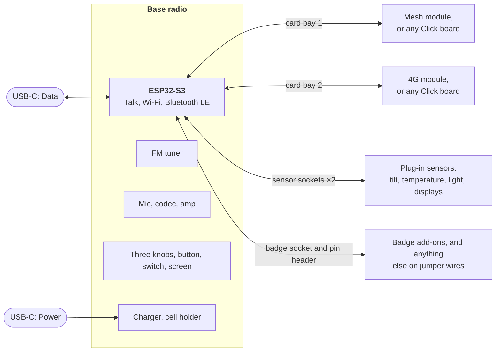

# A modular base radio can be made for about NZ$33, and three of the ideas need changing

Nov 16, 2026 · @Chris Barlow

> **Accepted on 16 November 2026.** Every recommendation here is now a decision: see decisions 13 to 23 in [Design Decisions](../docs/Design%20Decisions.md). The report is kept as written, as the evidence.

## Summary

**The proposal: a cheap base radio that anyone can open up and add to.** Every radio has Talk, FM, Wi-Fi and Bluetooth. Mesh, mobile data and anything else plug in, with no soldering. It is simple enough for Pop, and it is the radio his younger self, the engineer and tinkerer, would have wanted to take the back off.

**It is viable and practical, and it costs less than the radio we have now.** A modular base comes to about **NZ$33 to make in a batch of 1,000** and NZ$44 in a batch of 100, before the case, speaker and battery cell. The all-in-one board in the [cost-down report](Custom%20PCB%20and%20cost-down.md) is NZ$45 and NZ$58.

| | To make, 1,000 | To make, 100 | Suggested price |
|---|---|---|---|
| **Base kit:** Talk, FM, Wi-Fi, Bluetooth, three knobs, screen, two USB-C | about NZ$33 | about NZ$44 | NZ$59 to 69 |
| Mesh module | about NZ$15 | about NZ$19 | NZ$29 |
| 4G module | about NZ$26 | not costed | NZ$45 to 55 |
| Base with mesh fitted | about NZ$48 | about NZ$62 | |
| *Today's all-in-one board, mesh included* | *about NZ$45* | *about NZ$58* | *NZ$79 to 99* |

- **Being modular costs about NZ$3 a radio.** A base with the mesh module fitted is NZ$48 against NZ$45 for the same parts on one board. The sockets on every base are about NZ$1.25 of that.
- **It cannot go much lower.** Dropping the battery holder gets a mains-only base to about NZ$31. A cheaper version of the main chip saves cents. Below that, the three knobs or the screen have to go, and then it is a different radio.
- **Three of the ideas do not work as described**, and each has a good substitute:

| Idea | Finding | Do this instead |
|---|---|---|
| Plug an external screen into the second USB-C port | **No.** The chip has no video output, and USB-C screens need one | The radio serves a web page on the home Wi-Fi. Any phone, tablet, laptop or TV becomes its big screen and keyboard, for nothing. It can also cast that page to a Chromecast or Google TV |
| Bluetooth on every radio | **Partly.** It is Bluetooth Low Energy only. Keyboards work. Bluetooth speakers, headphones and most hearing aids do not | Say "Bluetooth keyboards" and nothing wider. Offer Bluetooth audio later as a module |
| A 4G or 5G modem | **4G yes, 5G not yet.** A 5G module costs three to four times a 4G one | Make the modem bay generic, so a cheaper 5G module can drop in when prices fall |

- **Borrow a card standard; do not invent one.** Small devices such as the Flipper Zero and M5Stack's Cardputer already take plug-in cards. The best fit here is mikroBUS: a push-in card format with more than 1,700 boards made for it. Our mesh and 4G modules can be that shape, so each bay also takes any of those cards. See [What other devices do](#what-other-devices-do).
- **The second USB-C port is still worth having.** It plugs in a keyboard, a USB stick or a computer. It just cannot drive a screen.
- **The biggest cost of the proposal is not money.** If mesh is optional, fewer radios carry it, and yesterday's decision that every Pop's Radio is a link in the mesh goes. The fix is to fit the mesh module to every built radio and leave it out of the bare kit only.

Prices are list prices and my estimates on 16 November 2026, on the same basis as the cost-down report: NZ$1.81 to the US dollar, 15% GST, JLCPCB assembly. Lines marked *estimate* are mine. Nothing here is quoted.

## The idea

| | The radio as decided | The modular proposal |
|---|---|---|
| Who it is for | Pop, and his family | Pop, his family, and people who like to open things up |
| In every radio | Talk, FM, Wi-Fi, mesh, tilt sensor | Talk, FM, Wi-Fi, Bluetooth |
| Plugs in | 4G | Mesh, 4G, and anything else |
| Inside the case | Four boards, closed | Four boards, with marked bays, sockets and screw points |
| USB-C | One port | Two ports |
| The promise | "A simple radio for Pop" | The same, and "the radio his younger self would have opened" |

**The two audiences do not pull against each other as much as they seem to.** Pop never sees a socket: they are inside, behind a back panel held by screws. The tinkerer never has to fight the product to get in: the back comes off with a screwdriver and the sockets are labelled.

## What works, and what does not

### The second USB-C port, and the external screen

**A USB-C screen will not work.** Portable USB-C monitors need the host to send a video signal, normally DisplayPort Alt Mode; a data-only USB-C port does not carry video ([Plugable](https://kb.plugable.com/en_US/understanding-usb-c-alt-mode), [StarTech](https://www.startech.com/en-us/blog/dp-alt-mode-performance-benefits)). The ESP32-S3 has no video output at all, and its USB is the slow 12 Mbit/s kind, so the software route that docks use (DisplayLink, over USB 3) is out too.

**What gives a big screen for nothing.** The radio can serve a small web page on the home Wi-Fi. Open it on a phone, a tablet, a laptop or a smart TV and that device is the radio's screen and keyboard: read and type messages, set stations, see the mesh. No cable, no extra part, and it works with the screens people already own.

**Casting to a TV.** Casting comes in two kinds, and only one is possible.

| Kind | How it works | On this chip |
|---|---|---|
| **Mirroring** (Miracast, AirPlay screen mirroring) | The device films its own screen and sends video | **No.** It needs a video encoder the chip does not have |
| **Cast a link** (Chromecast, Google TV) | The device tells the TV to fetch something from an address, and the TV does the work | **Yes, in principle.** The radio sends a short instruction; the TV loads the page or the stream |

- **Casting is the web page, with a button.** The TV has to fetch its picture from somewhere, and that somewhere is the page the radio serves. So casting adds "send it to the TV" from the radio's own knobs, with no phone needed. It does not replace the page.
- **Showing a page needs a small registered app.** Google's built-in receiver plays sound, pictures and video with no sign-up. Showing our own page needs a "custom receiver" registered with Google, for about US$5 ([Google](https://developers.google.com/cast/docs/registration)).
- **Internet radio casts with no page at all.** The radio hands the TV or a cast speaker the station's address and it plays there. That is the easy win.
- **Chromecast and Google TV only.** Apple TV and most other smart TVs do not accept it. The web page works on all of them.
- **Never cast Talk.** A family's voices should not go to a television in another room.
- **Not tested.** Hobby projects cast from ESP chips; I have not checked one on the ESP32-S3, or how much memory the secure link takes beside voice.

**What the second port is good for.**

| Use | Works | Notes |
|---|---|---|
| A USB keyboard | Yes | The radio acts as the host and must supply 5 V on that port |
| A USB stick, for music or logs | Yes | |
| A computer: loading firmware, a text console | Yes | The radio acts as a device |
| MIDI and serial gadgets | Yes | For tinkerers |
| A screen | No | No video output |
| Fast devices: webcams, USB audio at high rates | No | 12 Mbit/s only |

**One port does the data.** The ESP32-S3 has two USB controllers but one built-in USB connection, shared between them, so only one USB job runs at a time ([Espressif](https://docs.espressif.com/projects/esp-iot-solution/en/latest/usb/usb_overview/usb_phy.html)). So the two ports get fixed jobs: one marked **Power**, which only charges, and one marked **Data**, which is a host or a device as needed. A power switch with a current limit feeds 5 V out of the Data port, about US$0.15 (*estimate*). Most ESP32-S3 dev boards do not supply 5 V on their USB-C port, which is why keyboards often fail on them ([osrtos](https://osrtos.com/projects/esp32-s3-usb-to-ble-keyboard-bridge)).

**If a real screen output ever matters,** it needs a different class of chip. Espressif's ESP32-P4 can drive a larger built-in panel and has fast USB, on boards from US$11.90 ([LinuxGizmos](https://linuxgizmos.com/risc-v-based-firebeetle-2-with-esp32-p4-starts-at-11-90/)), but it still cannot feed a USB-C monitor. That takes a small Linux computer, which is a different product at a different price.

### Bluetooth, and the keyboard

**Bluetooth keyboards work, if they are the Low Energy kind.** The ESP32-S3 has Bluetooth Low Energy only, with no Bluetooth Classic, as the [Stage 2 doc](../docs/Walkie-Talkie%20Beyond%20the%20R1%20Minimum%20Hardware.md#pairing-bluetooth-versus-qr) already noted. Espressif publishes a host example for Low Energy keyboards and mice ([Espressif](https://docs.espressif.com/projects/esp-idf/en/stable/esp32/api-reference/bluetooth/esp_hidh.html)). Most current keyboards are Low Energy; older ones are Classic only and will not pair. A USB keyboard in the Data port always works.

**Bluetooth audio does not work.** Speakers, headphones and most hearing aids use Bluetooth Classic. This matters for older users more than for tinkerers: "can it play through Pop's hearing aids?" is a fair question, and the answer is no. A small Bluetooth audio module in a bay could fix it later.

**Typing messages.** With a keyboard, the radio's screen shows a line to type on.

- **Over the mesh:** already possible. The mesh chip sends each line it is given as a text.
- **Over the internet, to the family app:** needs a text message added to the [service's](../docs/Walkie-Talkie%20Service%20Design.md) protocol, sealed like voice. Small, but new.
- **For Pop:** nothing changes. There is still nothing for him to do with the mesh, and no keyboard to find. Typing is for the person who plugged a keyboard in.

### Mobile data: 4G now, 5G later

| Module | Price, US$ | To make as a plug-in, NZ$ | Verdict |
|---|---|---|---|
| 4G (LTE Cat-1), A7670G | from 12.30 ([LCSC](https://www.lcsc.com/product-detail/C5846957.html)) | about 26 | Use this |
| 5G RedCap | about 40 to 55 in early 2026 (analyst figures, [ABI Research](https://www.abiresearch.com/press/as-device-oems-migrate-from-lte-and-5g-redcap-asps-halve-over-the-next-5-years-redcap-iot-module-revenue-will-hit-us12-billion)) | about 85 to 115 for the module alone | Too dear for a voice radio |
| 5G eRedCap | expected at 10 to 15 when it arrives (same source) | about 21 to 31 for the module alone | Watch |

**The radio needs about 24 kbit/s.** 4G carries that with room to spare, so 5G adds cost and nothing Pop would notice. I found no list price for a specific 5G RedCap module, only analyst ranges, so treat those as rough. The practical step is to make the modem bay generic: power, a serial line and a SIM, so a later module fits the same socket.

## What other devices do

**Plug-in cards are a solved problem, several times over.** These are the ones that matter, from smallest to largest.

| Standard | What it looks like | Where you see it | What it carries | Fit for Pop's Radio |
|---|---|---|---|---|
| **Qwiic / STEMMA QT** | A tiny 4-pin plug on a short cable | SparkFun and Adafruit sensor boards | Power and one shared data bus | **Use it.** Two sockets, for sensors and small displays |
| **Grove** | A larger 4-pin plug on a cable | Seeed boards, and M5Stack's "Unit" add-ons | The same, or two plain signal pins | An adapter cable from Qwiic covers it |
| **Badge add-on (SAO)** | A coin-sized card on a 2 × 3 pin plug | Hacker conference badges; hundreds of home-made cards on Tindie | 3.3 V, the shared bus and two spare pins ([Hackaday](https://hackaday.com/2019/03/20/introducing-the-shitty-add-on-v1-69bis-standard)) | **Add one, for fun.** It costs cents and it is the tinkerer's handshake |
| **Cardputer "Cap"** | A card that clips across the top of a pocket computer | M5Stack Cardputer-Adv, whose mesh radio is sold as a Cap, in a kit with the device ([M5Stack](https://docs.m5stack.com/en/cap/Cap_LoRa-1262), [Meshtastic](https://meshtastic.org/docs/hardware/devices/m5stack/cardputer/)) | Made for that one device | Proof that a mesh radio sold as a clip-on card works. Not a standard we can share |
| **Flipper Zero modules** | A card that sits on 18 pins along the top edge | Flipper Zero, with many third-party cards ([Flipper](https://docs.flipper.net/zero/gpio-and-modules)) | Power and general pins, with a published protocol for cards to announce themselves | The model to copy: open pins and a published protocol brought the add-ons |
| **mikroBUS ("Click" boards)** | A stamp-sized card that pushes onto two rows of 8 pins | MIKROE, and sockets on dev boards from Microchip, SparkFun and others | Three kinds of data link, six control pins, 3.3 V and 5 V ([MIKROE](https://www.mikroe.com/mikrobus)) | **Use it for the bays.** More than 1,700 cards exist ([The Debug Store](https://thedebugstore.com/pages/mikrobus)) |
| **MicroMod** | A card with a gold edge that slots in and is held by one screw | SparkFun | A whole processor's worth of pins, on a laptop-style M.2 slot | The nicest feel, but the cards cost more to make and the slot invites the wrong card |
| **Laptop modem slots (M.2, mini PCIe)** | The same slot, as used for laptop modems | Routers, laptops | USB | **No.** They need fast USB, which our chip has given to the Data port, and the modems cost 38 to 55 euros ([SOS electronic](https://www.soselectronic.com/en-ch/products/quectel/ec25euxga-128-sgns-320972)) against US$12.30 for ours |
| **Framework expansion cards** | A sliding USB-C block | Framework laptops | USB-C | No, for the same reason |
| **Feather, Raspberry Pi HAT** | A second board stacked on long pin rows | Adafruit, Raspberry Pi | Most of a processor's pins | Too many pins for the main chip to spare. Not checked in detail |

**What the successful ones share.**

- **A socket that is cheap on the host.** Pin sockets cost cents. The cost sits on the card, where the buyer chooses it.
- **A published pinout.** The Flipper and the badge standard both grew because anyone could make a card.
- **One job per card.** Nobody opens a manual to plug in a Qwiic sensor.

**The recommendation: make our two radio bays mikroBUS sockets.** The mesh chip needs power, a serial line, a reset line and one more control pin. A mikroBUS socket has all of those. So does the 4G modem, with one addition: a separate battery feed beside the socket for its bursts of current. Build our modules to that shape and each bay does two jobs: it takes our mesh or 4G module, and when it is empty it takes any Click board. That replaces a private connector with one that has a catalogue behind it. Two things to check first: MIKROE's terms for using the name and the mark, and whether the pins stretch to two full sockets.

## Opening it up: the expansion design

**Use sockets other people already make things for.** A private connector means we have to make every add-on ourselves. A common one means hundreds of existing boards plug straight in.

| Socket | What it carries | What plugs in | Cost on every base, US$ |
|---|---|---|---|
| **Card bay 1** (mikroBUS) | Power, a serial line, reset and control lines, the shared buses, an antenna hole in the case | The mesh module, which the radio can update. Or any Click board | about 0.15 (*estimate*) |
| **Card bay 2** (mikroBUS, with a battery feed beside it) | The same, plus battery power for bursts | The 4G module, or a later 5G one. Or any Click board | about 0.15 (*estimate*) |
| **Two sensor sockets** | The small 4-pin plug used by SparkFun's Qwiic and Adafruit's STEMMA QT | Existing sensor and display boards, on a cable, with no soldering | about 0.10 (*estimate*) |
| **A badge socket and a pin header** | 3.3 V, the shared bus and a few spare pins | Badge add-on cards, and jumper wires for experiments | about 0.20 (*estimate*) |
| **Screw points** | A grid of holes and posts inside the case | Somewhere to fix what was plugged in | In the case, not the board |

- **The sensor socket is the cheap win.** Qwiic and STEMMA QT use the same plug and the same wiring ([Adafruit](https://learn.adafruit.com/introducing-adafruit-stemma-qt?view=all), [Hackaday](https://hackaday.com/2022/05/04/the-connector-zoo-i2c-ecosystems)). Boards chain one to the next. The tilt sensor moves off the base and becomes the first plug-in.
- **The case already has the room.** At 220 × 125 × 80 mm it is far bigger than the boards need, which was a cost. For this proposal it is the asset: there is space for bays, and both the printed and the plywood case can carry screw posts.
- **The main chip runs out of pins.** Three knobs, the screen, audio, two radio bays and USB use nearly every pin the ESP32-S3 module has, on my count. A pin-expander chip, about US$0.30 (*estimate*), moves the knobs and switches off the main chip and frees pins for the header. It has to go in the board from the start.
- **Power needs a budget.** A keyboard on the Data port, the speaker at full volume and a modem sending can all draw at once. The charger chip's 5 V supply has to be sized for the worst case, or the firmware has to refuse some combinations. Not checked yet.

## Revised cost analysis

### The base, part by part

| Part | 1,000, US$ | 100, US$ | Against today's board |
|---|---|---|---|
| ESP32-S3-WROOM-1-N16R8 | 3.55 | 3.78 | Same |
| Codec, amp, microphone | 0.72 | 0.87 | Same |
| FM tuner module | 0.80 | 0.80 | Same |
| 2.4 inch screen | 2.35 | 2.57 | Same |
| Three encoders | 1.14 | 3.30 | Same |
| Talk switch, slide switch, lights | 0.20 | 0.20 | Same |
| Charger and power parts | 0.31 | 0.35 | Same |
| Two USB-C ports, protection, 5 V switch | 0.30 | 0.40 | Was one port, 0.10 (*estimate*) |
| 18650 holder | 0.94 | 1.00 | Same |
| FM aerial wire | 0.40 | 0.40 | The mesh antenna moves to its module (*estimate*) |
| Board-to-board cables | 0.30 | 0.30 | Same |
| Passives and small parts | 0.80 | 0.90 | Same |
| Pin expander | 0.30 | 0.35 | New (*estimate*) |
| Sockets: two card bays, two sensor sockets, badge socket, pin header | 0.60 | 0.70 | New (*estimate*) |
| ~~Mesh chip~~ | | | Moves to a module: saves 5.50 |
| ~~Tilt sensor~~ | | | Moves to a plug-in: saves 0.50 |
| **Parts** | **12.71** | **15.92** | 18.41 and 22.84 |
| Board and assembly | 2.70 | 4.20 | Same |
| Freight | 0.40 | 1.00 | Same |
| **US$ per base** | **15.81** | **21.12** | 21.51 and 28.04 |
| **NZ$ incl. GST** | **about 33** | **about 44** | about 45 and 58 |

### The modules

| Module | What is on it | To make, 1,000 | To make, 100 |
|---|---|---|---|
| Mesh | HT-CT62 (US$5.50), 915 MHz antenna, a small carrier board and plug (*estimate* US$0.80) | about NZ$15 | about NZ$19 |
| 4G | A7670G, SIM holder, antenna, board and plug | about NZ$26 | not costed |
| Tilt sensor | A bought Qwiic board, or our own at about US$1 (*estimate*) | about NZ$2 | |

### How low can it go

| Step | Saves, NZ$ | Costs you |
|---|---|---|
| Start: modular base | | about NZ$33 |
| Leave off the battery holder: mains only | about 2.40 | It cannot leave its stand. Battery becomes a module |
| A main chip with less memory (N8R2) | under 1 | LCSC lists it from US$3.25 to 3.51 against 3.55 ([LCSC](https://www.lcsc.com/product-detail/C2913204.html)), and voice wants the memory. Not worth it |
| A small one-colour OLED for the screen | about 2 (*estimate*) | No games, small text. Against the brief |
| One knob, not three | about 2, and two small boards | It is the first bedside radio again, about NZ$25 |

**The practical floor is about NZ$31,** mains only. The honest answer to "dirt cheap" is that the base is cheap for what it is, and it is not a NZ$10 gadget: most of the cost is the main chip, the screen, the knobs and the factory's work, and those are in every radio.

### What a tinkerer pays, against the alternatives

A base kit at NZ$59 to 69, plus a speaker (about NZ$8), a cell (NZ$12.50) and a case printed at home, is a working radio for about **NZ$80 to 90**.

| Product | Price | In NZ$, before GST and freight |
|---|---|---|
| Pop's Radio base kit, complete as above | | about 80 to 90, with GST |
| M5Stack CoreS3 SE | US$38.60 in 2024 ([CNX Software](https://cnx-software.com/2024/05/31/m5stack-cores3-se-cost-down-esp32-s3-iot-controller-features-a-2-inch-touch-display-a-microsd-card-slot-a-speaker-two-microphones/)) | about 70 |
| M5Stack CoreS3 | US$59.90 in 2024 (same source) | about 108 |
| LilyGO T-Deck Plus, with mesh radio and keyboard | from US$61.34 ([LilyGO](https://lilygo.cc/collections/lilygo-with-meshtastic)); US$90 to 95 on Amazon in July 2026 | about 111 to 172 |
| Flipper Zero | US$169 to 199 ([Flipper](https://shop.flipperzero.one/products/flipper-zero)) | about 306 to 360 |

**It is priced like the cheap end of that shelf, and it is the only one built as a radio for the bedside.** None of the others has three big knobs, a loud speaker or a button a palm can find. The M5Stack and T-Deck prices are from 2024 and third-party listings, so check them before quoting.

### What modular costs beyond parts

- **More things to stock.** A base, two modules, two cases, a speaker. Each needs a box, a listing and a spare.
- **More combinations to support.** "My radio does X" now depends on what is plugged in.
- **Cash.** 1,000 bases is about NZ$33,000, against NZ$45,000 for 1,000 all-in-one boards, and modules can be ordered in smaller batches as they sell. That is a real advantage.
- **Certification.** The base alone has one pre-approved radio module, the cheapest case in the cost-down report: about US$3,000 to 8,000 ([Predictable Designs](https://predictabledesigns.com/certification-costs-what-it-really-takes/)). Whether a mesh or 4G module that the owner plugs in needs the whole radio declared again is a question for RSM, and the answer shapes the business.

## From all angles

### Brand

**"The radio his younger self would have opened" is a strong line, and it is true to the project.** It does three things at once.

- **It respects the user.** Most products for older people speak down to them. This one says he was an engineer.
- **It explains the price of simplicity.** The outside is simple on purpose, not because the inside is.
- **It gives grandchildren a way in.** The person who builds the kit and adds the module is likely to be the one who set the radio up.

**The risk is the picture it paints of Pop's own radio.** A family choosing a device for a frail parent wants "it just works", not "expandable". So the two messages need separate rooms: the front page stays Pop's, and the tinkering lives on its own page.

### Market

- **A second market that does not need the first to succeed.** Makers buy boards the family market never would, and they buy worldwide. The [market report](NZ%20addressable%20market%20and%20opportunities.md) found the family business only works with sales beyond New Zealand; hobbyists are the easier export.
- **It is a crowded shelf.** M5Stack, LilyGO and others sell capable ESP32-S3 devices at these prices with large followings. A new platform is not chosen for its sockets. It is chosen for a reason the others lack, and here that is the form: a real radio with real knobs, and a story.
- **Makers are also the first installers.** Every mesh needs its early nodes, and every family needs someone to set the radio up.

### Safety and trust

- **The microphone rule becomes a hardware rule.** "Nobody can switch the microphone on from somewhere else" is kept today by our firmware. An open radio can run anyone's firmware. The red light is already wired to the microphone's power, so it cannot be turned off in software; that wiring is now the guarantee, and it must never be made optional.
- **Two kinds of radio.** A built radio for Pop has its firmware locked to our signing key. A kit does not, as the service design already says for home-built boards. Locking is permanent, so it is a choice made once, at the factory or by the owner.
- **A changed radio on a family channel.** A radio running someone else's firmware still holds its own channel keys. That is the owner's own family, so it is their risk to take, but the family app should show which radios run official firmware.
- **Lithium cells and an open back.** The back panel is screwed, not clipped, and the cell holder has reverse-polarity protection on the board.
- **The kids' mini phone stays closed.** No bays, no header, no mesh.

### Licence

**The current licence will slow a hobbyist platform.** Code is PolyForm Noncommercial and documents CC BY-NC-SA. Makers expect to be able to build and sell add-ons, and "non-commercial" stops that without a licence from us ([COMMERCIAL.md](../COMMERCIAL.md)).

- **Publish the socket specification freely**, so anyone may make and sell a module that plugs in. Keep the radio's own design and firmware as they are.
- **Say so plainly.** "Open to add to, not open to copy" is a fair position, and it should be on the page before a maker asks.

### Firmware and software

- **The update system already carries it.** Signed nightly updates exist in the design; modules are found at start-up and switched on if present.
- **Each module is firmware work.** Mesh and 4G are already planned. Every later module needs a driver, a test and support.
- **The tinkerer's route is already there.** The ESP32-S3 runs Arduino, ESP-IDF, MicroPython and CircuitPython, and the web flasher puts the official firmware back.

## Is it viable? Is it practical?

| Question | Answer | Why |
|---|---|---|
| Can it be built? | **Yes** | It is today's board with one chip moved to a module, a second USB-C port and some sockets |
| Is it cheaper? | **Yes, for the base** | About NZ$33 against NZ$45. About NZ$3 dearer fully loaded |
| Is it practical to make? | **Yes** | Same factory, same panel, less cash tied up in each batch |
| Is it practical to use? | **Yes for tinkerers, unchanged for Pop** | The sockets are inside |
| Does every idea work? | **No** | No USB-C screen, no Bluetooth audio, no 5G yet |
| Is it a business? | **Not proven** | A second market, on a crowded shelf, with an open licence question |
| What could stop it? | Three things | The regulator's view on plug-in radios, a thinner mesh, and support for too many combinations |

**My read: do it, in the narrow form.** Two card bays in a standard shape for mesh and mobile data, two sensor sockets, a badge socket and pin header, two USB-C ports. That is cheap, it is real, and it does not ask Pop to notice. Leave "external screen" and "5G" out of the promise, and say "Bluetooth keyboards", not "Bluetooth".

## What this would change

| Decision | Now | Under this proposal |
|---|---|---|
| 4. The parts | One USB-C port; tilt sensor on the board | Two USB-C ports, a pin expander, sockets; tilt sensor plugs in |
| 7. Mesh as a co-processor | On the main board | The same chip, on a plug-in module |
| 8. Mesh always on, in every radio | Every Pop's Radio is a link | Every *built* radio is a link. A bare kit is not, until its owner adds the module |
| 9. Kit or built | Two ways to buy | The kit becomes a base plus modules |
| 12. 4G as a plug-in | Decided today | Unchanged. This proposal is that idea, extended |

**Decision 8 is the one to think hardest about.** A mesh is worth more with every radio in it. The proposal keeps that for the radios families buy and gives it up for the cheapest kit.

## Risks and open questions

| Risk | Impact | Mitigation |
|---|---|---|
| RSM treats a plug-in radio module as a new product each time | Modules cannot be sold separately | Ask before drawing the board; fall back to factory-fitted options |
| Fewer radios on the mesh | The mesh is thinner where it is needed | Fit the mesh module to every built radio |
| Not enough pins or power | Sockets that cannot all be used at once | Count pins and current on paper before layout; add the pin expander |
| "Expandable" worries families | Fewer sales to the people it is for | Keep the tinkering off the front page |
| A crowded maker market | Few hobbyist sales | Lead with the form and the story, not the sockets |
| The licence puts makers off | No add-ons from others | Publish the socket specification freely |
| Support for many combinations | Time | Support our own modules; mark the rest "for experiments" |
| Prices are list and estimates | Totals move | The same real quote the cost-down report needs |

**Unconfirmed:** the pin count, which I did from the module's pin list and not from a drawn board, and which two full mikroBUS sockets make tighter; MIKROE's terms for the mikroBUS name; what Grove, Feather and HAT boards would need, which I described from memory; the 5 V power budget; current prices for the M5Stack and T-Deck products; any specific 5G module's price; and how RSM treats owner-fitted radio modules.

## Next steps

1. **Ask RSM about owner-fitted radio modules.** It decides whether modules are a product or only a factory option.
2. **Count the pins and the power on paper**, with both bays, two sensor sockets, the header and a keyboard on the Data port.
3. **Try the two awkward claims on a dev board:** a Low Energy keyboard typing a line onto the screen, and the radio's web page open on a phone.
4. **Decide decision 8.** Mesh in every radio, or only in built ones.
5. **Check MIKROE's terms** for building mikroBUS sockets and cards, then write our own socket page and decide its licence.
6. **Then draw the board once,** with the sockets in.

## Sources

- USB on the ESP32-S3: [Espressif, USB PHY](https://docs.espressif.com/projects/esp-iot-solution/en/latest/usb/usb_overview/usb_phy.html) · [Espressif, USB device stack](https://docs.espressif.com/projects/esp-idf/en/v6.0/esp32s3/api-reference/peripherals/usb_device.html) · [5 V on dev board ports](https://osrtos.com/projects/esp32-s3-usb-to-ble-keyboard-bridge)
- USB-C screens: [Plugable, Alt Mode](https://kb.plugable.com/en_US/understanding-usb-c-alt-mode) · [Plugable, DisplayLink and Alt Mode](https://kb.plugable.com/usb-c-docks/what-is-the-difference-between-the-displaylink-vs-alt-mode-mst-ports) · [StarTech](https://www.startech.com/en-us/blog/dp-alt-mode-performance-benefits) · [ESP32-P4 boards](https://linuxgizmos.com/risc-v-based-firebeetle-2-with-esp32-p4-starts-at-11-90/)
- Bluetooth keyboards: [Espressif, HID host](https://docs.espressif.com/projects/esp-idf/en/stable/esp32/api-reference/bluetooth/esp_hidh.html)
- Modems: [A7670G at LCSC](https://www.lcsc.com/product-detail/C5846957.html) · [ABI Research on 5G RedCap prices](https://www.abiresearch.com/press/as-device-oems-migrate-from-lte-and-5g-redcap-asps-halve-over-the-next-5-years-redcap-iot-module-revenue-will-hit-us12-billion)
- Card and socket standards: [mikroBUS](https://www.mikroe.com/mikrobus) · [Click board count](https://thedebugstore.com/pages/mikrobus) · [badge add-on standard](https://hackaday.com/2019/03/20/introducing-the-shitty-add-on-v1-69bis-standard) · [Flipper Zero modules](https://docs.flipper.net/zero/gpio-and-modules) · [Flipper expansion protocol](https://developer.flipper.net/flipperzero/doxygen/expansion_protocol.html) · [Cardputer Cap LoRa-1262](https://docs.m5stack.com/en/cap/Cap_LoRa-1262) · [Cardputer mesh kit](https://meshtastic.org/docs/hardware/devices/m5stack/cardputer/) · [SparkFun MicroMod and mikroBUS](https://learn.sparkfun.com/tutorials/micromod-mikrobus-carrier-board-hookup-guide/all) · [EC25 mini PCIe prices](https://www.soselectronic.com/en-ch/products/quectel/ec25euxga-128-sgns-320972)
- Sensor sockets: [Adafruit, STEMMA QT](https://learn.adafruit.com/introducing-adafruit-stemma-qt?view=all) · [Hackaday, I2C connector ecosystems](https://hackaday.com/2022/05/04/the-connector-zoo-i2c-ecosystems)
- Parts: [ESP32-S3-WROOM-1-N8R2 at LCSC](https://www.lcsc.com/product-detail/C2913204.html) · every other part price is from the [cost-down report](Custom%20PCB%20and%20cost-down.md)
- Other products: [M5Stack CoreS3 and CoreS3 SE](https://cnx-software.com/2024/05/31/m5stack-cores3-se-cost-down-esp32-s3-iot-controller-features-a-2-inch-touch-display-a-microsd-card-slot-a-speaker-two-microphones/) · [LilyGO T-Deck](https://lilygo.cc/collections/lilygo-with-meshtastic) · [Flipper Zero](https://shop.flipperzero.one/products/flipper-zero)
- Certification: [Predictable Designs](https://predictabledesigns.com/certification-costs-what-it-really-takes/)
